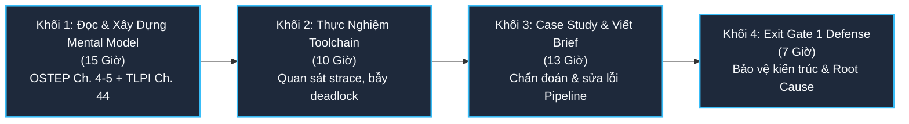

# 📘 PHASE 1: EXECUTION BOUNDARIES & RESOURCE LIFECYCLES
## CẨM NANG HỌC TẬP VÀ THỰC NGHIỆM DUY NHẤT (THE DEFINITIVE STUDY GUIDE)

> **Vị Trí**: Phase 1 — Foundational Systems Architecture  
> **Khung Thời Gian Khóa Chặt**: 01/11/2026 — 11/11/2026 (1.5 Tuần / 45 Giờ)  
> **Ngân Sách Giờ**: 45 Giờ học chủ động (thuộc tổng 360 giờ học của toàn lộ trình)  
> **Mục Tiêu Tối Thượng**: Làm chủ ranh giới thực thi (Execution Boundary), mô hình cô lập lỗi (Fault Isolation), vòng đời tham chiếu tài nguyên (3-Tier FD Model) và cơ chế điều tiết dòng chảy (Pipe Backpressure).

---

## MỤC LỤC
1. [Kế Hoạch Thực Chiến 45 Giờ & Trạng Thái Nền Tảng Của Bạn](#1-kế-hoạch-thực-chiến-45-giờ--trạng-thái-nền-tảng-của-bạn)
2. [Phạm Vi Đọc Phẫu Thuật (Surgical Reading Scope)](#2-phạm-vi-đọc-phẫu-thuật-surgical-reading-scope)
3. [Trụ Cột Kiến Trúc 1: Ranh Giới Thực Thi & Cô Lập Lỗi (Execution & Fault Isolation)](#3-trụ-cột-kiến-trúc-1-ranh-giới-thực-thi--cô-lập-lỗi-execution--fault-isolation)
4. [Trụ Cột Kiến Trúc 2: Quản Lý Tài Nguyên & Mô Hình 3 Tầng (Resource Ownership & 3-Tier Model)](#4-trụ-cột-kiến-trúc-2-quản-lý-tài-nguyên--mô-hình-3-tầng-resource-ownership--3-tier-model)
5. [Trụ Cột Kiến Trúc 3: Đường Ống Dữ Liệu & Điều Tiết Dòng Chảy (Pipes & Backpressure)](#5-trụ-cột-kiến-trúc-3-đường-ống-dữ-liệu--điều-tiết-dòng-chảy-pipes--backpressure)
6. [Thực Nghiệm Toolchain: Quan Sát Hệ Thống Bằng `strace`](#6-thực-nghiệm-toolchain-quan-sát-hệ-thống-bằng-strace)
7. [Case Study Thực Nghiệm: Pipeline Isolation & Leak Diagnostics Lab](#7-case-study-thực-nghiệm-pipeline-isolation--leak-diagnostics-lab)
8. [Bộ Tiêu Chuẩn & Câu Hỏi Thẩm Định Exit Gate 1 (Defense Rubric)](#8-bộ-tiêu-chuẩn--câu-hỏi-thẩm-định-exit-gate-1-defense-rubric)

---

<a id="1-kế-hoạch-thực-chiến-45-giờ--trạng-thái-nền-tảng-của-bạn"></a>
## 1. Kế Hoạch Thực Chiến 45 Giờ & Trạng Thái Nền Tảng Của Bạn

Lộ trình Phase 1 kéo dài đúng **1.5 tuần (45 giờ)**, phân bổ vào 4 khối hoạt động chuẩn mực:



### Đối Chiếu Nền Tảng Thực Tế Của Bạn:
* **Đã thành thạo (C++ Toolchain, RAII, Smart Pointers)**: **0 giờ học lại**. Áp dụng ngay vào đọc hiểu codebase; không mở lại tài liệu C++ cơ bản.
* **Đã học (Day 001–003: User/Kernel mode, Process VAS, `fork`/`exec`/`waitpid`, UID/GID)**: **Dành 5 giờ rà soát nhanh** các câu hỏi ranh giới trong tài liệu này; không đọc lại từ đầu.
* **Đã học nhưng chưa vững (Mô hình 3 tầng FD, CLOEXEC race, Pipe Flow Control)**: **Dành 10 giờ củng cố trọng điểm** về các quy luật nhân quả (causal invariants).
* **Thời gian còn lại (30 giờ)**: Dồn toàn bộ vào thực nghiệm `strace`, giải quyết Case Study có sẵn hạ tầng, viết bản Security Risk Brief và chuẩn bị bảo vệ Exit Gate 1.

---

<a id="2-phạm-vi-đọc-phẫu-thuật-surgical-reading-scope"></a>
## 2. Phạm Vi Đọc Phẫu Thuật (Surgical Reading Scope)

Chỉ đọc đúng các chương/mục tinh hoa sau (tổng cộng dưới 40 trang). **Tuyệt đối không đọc lan man**:

| Tài liệu chuẩn mực | Phạm vi đọc bắt buộc | Trọng tâm cần nắm |
| :--- | :--- | :--- |
| **OSTEP (Arpaci-Dusseau)** | • **Chương 4**: *The Abstraction: The Process*<br>• **Chương 5**: *Interlude: Process API* | • Khái niệm Process, PCB, không gian địa chỉ ảo (VAS).<br>• Bộ ba API `fork()`, `execve()`, `waitpid()` và cơ chế I/O Redirection. |
| **TLPI (Michael Kerrisk)** | • **Chương 44**: *Pipes and FIFOs* (Chỉ đọc mục 44.1 & 44.2) | • Cơ chế đệm (Pipe Buffer 64KB), quy luật blocking khi buffer đầy.<br>• Điều kiện EOF (khi đóng hết write-ends) và tín hiệu `SIGPIPE`. |

> ❌ **Phần BỎ QUA trong Phase 1 (Không đọc để tránh lãng phí thời gian)**:  
> Bỏ qua các chương về File System Internals, Terminal I/O, Advanced POSIX IPC (Message Queues, Shared Memory), Signals chuyên sâu (`sigaltstack`, `sigaction` flags phức tạp), các bảng thanh ghi và ngắt x86.

---

<a id="3-trụ-cột-kiến-trúc-1-ranh-giới-thực-thi--cô-lập-lỗi-execution--fault-isolation"></a>
## 3. Trụ Cột Kiến Trúc 1: Ranh Giới Thực Thi & Cô Lập Lỗi (Execution & Fault Isolation)

### 3.1. Phân Định 4 Tầng Trừu Tượng Thực Thi
Là một System Architect, bạn phải phân biệt chính xác 4 khái niệm thường bị nhầm lẫn:
1. **Program (Chương trình)**: Thuật toán và logic thuần túy trên bản vẽ thiết kế.
2. **Executable File (Tệp thực thi ELF)**: Thực thể tĩnh lưu trên ổ đĩa. Chứa mã máy (`.text`), dữ liệu khởi tạo (`.data`), kích thước biến chưa khởi tạo (`.bss`) và các bảng ký hiệu.
3. **Program Image**: Bản đồ biểu diễn bộ nhớ trong RAM khi tệp thực thi được nạp vào Không gian Địa chỉ Ảo (VAS). Gồm các phân đoạn với quyền bảo vệ nghiêm ngặt:
   - Phân đoạn Code (`.text`): Read-only + Executable (`r-x`).
   - Phân đoạn Data/BSS: Read-Write + Non-executable (`rw-`).
   - Heap: Cấp phát động, mở rộng lên trên (`brk`/`mmap`).
   - Stack: Cục bộ cho hàm và biến local, mở rộng xuống dưới.
4. **Process (Tiến trình)**: Thực thể sống, độc lập được Kernel quản lý qua Process Control Block (`task_struct`). Sở hữu VAS riêng, PID, credentials, bảng File Descriptors và trạng thái thanh ghi CPU.

```
+-------------------------------------------------------+ 0xFFFFFFFFFFFFFFFF
| Kernel Space (Chỉ truy cập được ở Kernel Mode / Ring 0)|
+-------------------------------------------------------+ 0xFFFF800000000000
| User Stack (Mở rộng xuống phía dưới)                 |
|   | v                                                 |
|   v                                                   |
| Heap (Mở rộng lên phía trên thông qua brk/mmap)       |
|   ^                                                   |
|   |                                                   |
| Data Segment (.data đã khởi tạo, .bss chưa khởi tạo)  |
+-------------------------------------------------------+
| Text Segment (.text mã máy, Read-only / Executable)   |
+-------------------------------------------------------+ 0x0000000000400000
```

> **Tại sao `execve()` thay thế Program Image mà không tạo Process mới?**  
> `execve()` hủy toàn bộ VAS cũ, nạp mã nhị phân mới vào VAS, nhưng **giữ nguyên PID, PPID, vị trí trong cây tiến trình và các File Descriptors đang mở (nếu không có cờ CLOEXEC)**. Đây là cơ chế nền tảng để Shell thiết lập chuyển hướng I/O trước khi bàn giao quyền thực thi.

### 3.2. Ranh Giới Đặc Quyền (Privilege Boundary: User vs Kernel)
* **User Mode (Ring 3)**: Chế độ bị hạn chế. CPU cấm thực thi các chỉ thị nhạy cảm (như can thiệp phần cứng, sửa bảng phân trang bộ nhớ).
* **Kernel Mode (Ring 0)**: Chế độ đặc quyền tối cao. CPU có toàn quyền truy cập bộ nhớ vật lý và phần cứng.
* **Chi phí vượt ranh giới (Syscall Overhead)**: Mỗi lệnh gọi hệ thống (`syscall`) bắt buộc CPU phải:
  1. Chuyển đổi mức đặc quyền (Mode switch từ User ➔ Kernel).
  2. Lưu ngữ cảnh thanh ghi người dùng vào Kernel Stack.
  3. Kiểm tra tính hợp lệ của tham số bộ nhớ truyền vào (Security check).
  4. Thực thi logic trong kernel và khôi phục ngữ cảnh (Mode switch Kernel ➔ User).  
  *Hệ quả kiến trúc*: Giảm thiểu số lượng syscalls (thông qua I/O buffering ở user space) là nguyên tắc tối ưu hóa throughput sống còn.

### 3.3. Cô Lập Lỗi (Fault Isolation)
Mỗi process sở hữu một VAS độc lập do MMU (Memory Management Unit) bảo vệ. Một lỗi truy cập bộ nhớ trái phép (`SIGSEGV`) hoặc lỗi logic làm crash một tiến trình **hoàn toàn không thể làm hỏng bộ nhớ của tiến trình khác hay của OS**.  
*Bài học kiến trúc*: Trong các hệ thống đòi hỏi tính sẵn sàng cao (High Availability), việc phân rã các tác vụ không đáng tin cậy thành các tiến trình độc lập (Multi-Process Architecture như Chromium, Nginx, PostgreSQL) bảo đảm sự cố chỉ cô lập trong một tiến trình mà không làm sập toàn bộ hệ thống.

### 3.4. Ranh Giới Bảo Mật & Nguyên Lý Đặc Quyền Tối Thiểu (Least Privilege)
* **Real UID (RUID)**: Xác định ai là chủ sở hữu thực sự của tiến trình (người khởi chạy).
* **Effective UID (EUID)**: Xác định quyền hạn thực tế mà tiến trình đang sử dụng khi truy cập tài nguyên (đọc/ghi file, bind port mạng < 1024).
* **Nguyên tắc Drop Privileges**: Một daemon service khởi chạy dưới quyền root (EUID = 0) để bind cổng mạng đặc quyền, sau đó **bắt buộc phải hạ quyền (drop privileges)** về tài nguyên người dùng thông thường (`nobody` hoặc user dịch vụ) trước khi xử lý dữ liệu từ mạng gửi về, nhằm thu hẹp bề mặt tấn công (Attack Surface).

### 3.5. Vòng Đời Tiến Trình & Trách Nhiệm Giám Sát (Supervision Lifecycle)
* **`fork()`**: Nhân bản tiến trình hiện tại bằng kỹ thuật Copy-on-Write (COW). Tiến trình con kế thừa bản sao VAS và các handles tài nguyên.
* **`waitpid()`**: Tiến trình cha đồng bộ và thu dọn trạng thái kết thúc của tiến trình con.
* **Zombie Process**: Tiến trình con đã kết thúc (`exit()`), giải phóng bộ nhớ, nhưng tiến trình cha chưa gọi `waitpid()`. Kernel bắt buộc phải giữ lại `task_struct` trong Process Table để lưu mã thoát (exit code). Quá nhiều Zombie sẽ làm cạn kiệt Process Table (PID exhaustion).
* **Orphan Process**: Tiến trình cha kết thúc trước tiến trình con. Tiến trình con bị mồ côi và được Kernel tự động bàn giao (reparent) cho tiến trình `init` (PID 1) để dọn dẹp khi chết.

---

<a id="4-trụ-cột-kiến-trúc-2-quản-lý-tài-nguyên--mô-hình-3-tầng-resource-ownership--3-tier-model"></a>
## 4. Trụ Cột Kiến Trúc 2: Quản Lý Tài Nguyên & Mô Hình 3 Tầng (Resource Ownership & 3-Tier Model)

### 4.1. Mô Hình 3 Tầng POSIX (The 3-Tier Architecture)
Tài nguyên trong hệ điều hành không bao giờ bị trói chặt vào một con số nguyên FD. POSIX thiết kế trừu tượng hóa tài nguyên theo mô hình 3 tầng:

```
[Tiến trình A]                    [Toàn Hệ Thống - Kernel]          [Hệ Thống Tệp / Thiết Bị]
Process FD Table                  Open File Description (OFD) Table Inode Table / VFS
+---------------+                 +--------------------------+      +-------------------+
| FD 0 (stdin)  |                 | OFD 1:                   |      | Inode 1042:       |
| FD 1 (stdout) | --------------> | - File Offset: 2048      | ---> | - File Data/Size  |
| FD 2 (stderr) |                 | - Status Flags: O_RDWR   |      | - Permissions     |
| FD 3 (file.log)|---\            | - Ref Count: 2           |      +-------------------+
+---------------+     \           +--------------------------+
                       \          +--------------------------+      +-------------------+
[Tiến trình B]          \-------> | OFD 2:                   | ---> | Inode 8901:       |
Process FD Table                  | - File Offset: 0         |      | - Device / Socket |
+---------------+                 | - Status Flags: O_RDONLY |      +-------------------+
| FD 3 (kế thừa)|---------------> | - Ref Count: 2           |
+---------------+                 +--------------------------+
```

1. **Bảng File Descriptor (Per-Process)**: Bảng mảng cục bộ của mỗi tiến trình. Mỗi chỉ mục là một số nguyên (FD 0, 1, 2...). Mỗi mục chứa:
   - Con trỏ trỏ tới một Open File Description (OFD) trong Kernel.
   - **File Descriptor Flags** (Duy nhất cờ `FD_CLOEXEC` tồn tại ở tầng này).
2. **Bảng Open File Description - OFD (System-Wide)**: Nằm trong bộ nhớ Kernel, dùng chung cho toàn hệ thống. Đại diện cho một *phiên mở tệp*. Chứa:
   - **Current File Offset**: Vị trí con trỏ đọc/ghi hiện tại.
   - **File Status Flags**: Chế độ mở (`O_RDONLY`, `O_WRONLY`, `O_NONBLOCK`, `O_APPEND`).
   - **Reference Count**: Số lượng FD từ các tiến trình đang trỏ vào OFD này.
3. **Bảng Inode / VFS (File System / Storage)**: Đại diện cho tệp vật lý, socket hoặc pipe thực tế. Chứa metadata, kích thước và khối dữ liệu đĩa.

### 4.2. Quy Luật Nhân Quả Khi Kế Thừa Tài Nguyên Qua `fork()`
* Khi tiến trình A gọi `fork()` sinh ra tiến trình B: Bảng FD của B được sao chép nguyên vẹn từ A.
* **Cả FD của A và FD của B đều cùng trỏ vào một OFD duy nhất trong Kernel**.
* **Hệ quả kiến trúc**: Tiến trình A đọc 100 bytes (con trỏ offset trong OFD nhảy từ 0 lên 100), tiến trình B đọc tiếp sẽ bắt đầu ngay từ byte thứ 100! Tiến trình A và B chia sẻ chung offset và status flags.
* **Reference Counting**: Khi tiến trình A gọi `close(FD)`, Kernel chỉ giảm `Ref Count` của OFD đi 1. Tài nguyên chỉ thực sự được giải phóng khi `Ref Count == 0`.

### 4.3. Rò Rỉ Tài Nguyên Qua Ranh Giới (Handle Leaks) & Cờ `O_CLOEXEC`
* Mặc định trong POSIX, khi một tiến trình gọi `execve()`, tất cả các File Descriptors đang mở đều **sống sót và được chuyển giao sang image mới**.
* **Nguy cơ an ninh (Security Risk)**: Nếu tiến trình cha mở file nhạy cảm (token, private key database) rồi gọi `execve("/bin/untrusted_app")`, tiến trình con có thể đọc ghi trực tiếp vào file nhạy cảm đó qua số FD kế thừa.
* **Cờ `FD_CLOEXEC` (Close-on-Exec)**: Yêu cầu Kernel tự động đóng FD này ngay trong quá trình chuyển giao `execve()`.
* **Cạm bẫy Race Condition trong môi trường đa luồng**:
  ```c
  // CÁCH CŨ (NGUY HIỂM):
  int fd = open("/secret/key", O_RDONLY);  // Khoảng hở race condition ở đây!
  fcntl(fd, F_SETFD, FD_CLOEXEC);
  ```
  Nếu một luồng khác thực hiện `fork()` + `execve()` đúng vào giữa 2 dòng lệnh trên, file nhạy cảm sẽ bị rò rỉ sang tiến trình con mới sinh!
* **Bài học thiết kế API nguyên tử (Atomic API)**: POSIX hiện đại bổ sung cờ nguyên tử `open(..., O_CLOEXEC)` và hàm `pipe2(fds, O_CLOEXEC)` để bật cờ CLOEXEC ngay tại thời điểm tạo handle, triệt tiêu hoàn toàn race condition.

---

<a id="5-trụ-cột-kiến-trúc-3-đường-ống-dữ-liệu--điều-tiết-dòng-chảy-pipes--backpressure"></a>
## 5. Trụ Cột Kiến Trúc 3: Đường Ống Dữ Liệu & Điều Tiết Dòng Chảy (Pipes & Backpressure)

### 5.1. Bản Chất Của Pipe: Bounded FIFO Stream Trong Kernel
Pipe là cơ chế IPC một chiều (unidirectional byte-stream) đơn giản nhưng hoàn hảo nhất của Unix:
* Không có ranh giới thông điệp (TCP-like byte stream).
* Được quản lý bởi một bộ đệm trong bộ nhớ Kernel với dung lượng giới hạn cố định (thường là **64 KB** trên Linux hiện đại).

```
[Producer Process]                                           [Consumer Process]
Write FD [1]                                                  Read FD [0]
     |                                                             ^
     | write()                                             read()  |
     v                                                             |
+----------------------------------------------------------------------+
| KERNEL PIPE BUFFER (Dung lượng giới hạn: 64 KB)                      |
| [ Byte 0 | Byte 1 | Byte 2 | ... | Byte N ]                          |
+----------------------------------------------------------------------+
```

### 5.2. Cơ Chế Backpressure Tự Nhiên Ở Tầng Hệ Điều Hành
* **Khi Buffer Trống (Empty)**: Consumer gọi `read()` sẽ bị Kernel chuyển trạng thái sang **Blocked (Sleeping)**, dừng thực thi chờ cho đến khi Producer ghi ít nhất 1 byte dữ liệu.
* **Khi Buffer Đầy (Full - đạt 64 KB)**: Producer ghi quá nhanh trong khi Consumer xử lý chậm. Khi bộ đệm đầy 64KB, lệnh `write()` của Producer sẽ bị Kernel **chặn đứng (Blocked)**! Producer không thể ghi thêm cho đến khi Consumer đọc bớt dữ liệu ra khỏi buffer.
* *Bài học kiến trúc*: Đây là hiện tượng **Backpressure (Áp lực ngược)** nguyên thủy nhất: Consumer tự động điều tiết tốc độ của Producer thông qua một Bounded Queue, ngăn chặn Producer làm cạn kiệt bộ nhớ RAM của hệ thống.

### 5.3. Hai Quy Luật Đứt Gãy Dòng Chảy (EOF & SIGPIPE)
1. **Quy luật kết thúc dòng chảy (End-Of-File - EOF)**:  
   Lệnh `read()` trên pipe chỉ trả về `0` (EOF) khi và chỉ khi: **TẤT CẢ các File Descriptors trỏ tới write-end của pipe trong toàn bộ hệ thống đã được đóng!**  
   *Nếu còn dù chỉ MỘT tiến trình giữ write-end mở, Consumer sẽ bị treo (blocked) vĩnh viễn chờ dữ liệu.*
2. **Quy luật gãy ống (`SIGPIPE` / `EPIPE`)**:  
   Nếu Consumer đã đóng toàn bộ read-ends (hoặc Consumer bị crash), Producer cố tình gọi `write()` vào pipe sẽ bị Kernel gửi ngay tín hiệu **`SIGPIPE`** (mặc định làm chết tiến trình Producer) và trả về mã lỗi `EPIPE`.  
   *Hệ quả kiến trúc*: Coordinator phải bắt tín hiệu `SIGPIPE` để không bị sập bất thường khi downstream service gặp sự cố.

### 5.4. Cạm Bẫy Deadlock Kinh Điển Khi Nối Ống (`cmd1 | cmd2`)
Xem xét trường hợp Coordinator sinh ra 2 tiến trình con: `Producer` và `Consumer`:
```c
int pfd[2];
pipe(pfd); // pfd[0] là read-end, pfd[1] là write-end

if (fork() == 0) { // Producer Child
    dup2(pfd[1], STDOUT_FILENO);
    close(pfd[0]); close(pfd[1]);
    execve("producer", ...);
}

if (fork() == 0) { // Consumer Child
    dup2(pfd[0], STDIN_FILENO);
    close(pfd[0]); close(pfd[1]);
    execve("consumer", ...);
}

// LỖI CHẾT NGƯỜI: Coordinator quên đóng pfd[1]!
// close(pfd[1]); <--- THIẾU DÒNG NÀY

waitpid(producer_pid, ...);
waitpid(consumer_pid, ...);
```
* **Kịch bản Deadlock**: Producer chạy xong và thoát. Nhưng Consumer không bao giờ đọc được EOF, vì chính Coordinator (tiến trình cha) vẫn đang mở `pfd[1]` (Ref Count của write-end vẫn là 1)! Consumer treo vĩnh viễn chờ EOF. Coordinator treo vĩnh viễn ở `waitpid(consumer_pid)`. Toàn bộ hệ thống đóng băng.

---

<a id="6-thực-nghiệm-toolchain-quan-sát-hệ-thống-bằng-strace"></a>
## 6. Thực Nghiệm Toolchain: Tự Viết & Đo Đạc Cơ Chế Bằng C++ (10 Giờ)

Dành **10 giờ** để tự tay viết 3 chương trình C++ nhỏ, biên dịch bằng `g++ -std=c++20` trên Linux/WSL2 và dùng `strace` để quan sát trực tiếp các cơ chế kernel:

---

### Lab 1.1: Quá trình tạo và nạp Image (`fork` & `execve`) trong C++
* **Cơ chế cần hiểu**: Quá trình nhân bản tiến trình con và thay thế toàn bộ VAS bằng một image thực thi mới mà không thay đổi PID.
* **Tự triển khai bằng C++ (`lab1_fork_exec.cpp`)**:
  ```cpp
  #include <iostream>
  #include <unistd.h>
  #include <sys/wait.h>

  int main() {
      pid_t pid = fork();
      if (pid == 0) { // Tiến trình con
          char* args[] = {(char*)"/bin/echo", (char*)"Hello from Child Process!", nullptr};
          execve("/bin/echo", args, environ);
          _exit(127); // Chỉ chạy nếu execve thất bại
      } else { // Tiến trình cha
          int status = 0;
          waitpid(pid, &status, 0);
          if (WIFEXITED(status)) {
              std::cout << "[Parent] Child exited with code: " << WEXITSTATUS(status) << std::endl;
          }
      }
      return 0;
  }
  ```
* **Quan sát / Đo đạc bằng công cụ**:
  Biên dịch và chạy qua `strace`:
  ```bash
  g++ -std=c++20 lab1_fork_exec.cpp -o lab1_fork_exec
  strace -f -e trace=clone,execve,wait4,exit_group ./lab1_fork_exec
  ```
* **Tiêu chí xác nhận**: `strace` hiển thị đúng chuỗi: `clone` sinh PID con ➔ con gọi `execve` nạp `/bin/echo` ➔ cha gọi `wait4` dừng chờ ➔ con thoát qua `exit_group(0)` ➔ cha in đúng exit code `0`.

---

### Lab 1.2: Bounded Pipe Buffer & Backpressure Trong C++
* **Cơ chế cần hiểu**: Pipe buffer trong kernel có dung lượng giới hạn cố định (64 KB). Khi buffer đầy, syscall `write()` của Producer bị Kernel chặn đứng (Blocked) — cơ chế Backpressure tự nhiên của hệ điều hành.
* **Tự triển khai bằng C++ (`lab1_pipe_backpressure.cpp`)**:
  ```cpp
  #include <iostream>
  #include <unistd.h>
  #include <vector>

  int main() {
      int pfd[2];
      pipe(pfd); // pfd[0]: read, pfd[1]: write
      
      std::vector<char> chunk(4096, 'X'); // Khối 4 KB
      size_t total_written = 0;

      std::cout << "[Producer] Bắt đầu ghi liên tục vào pipe mà không đọc..." << std::endl;
      while (true) {
          ssize_t bytes = write(pfd[1], chunk.data(), chunk.size());
          total_written += bytes;
          std::cout << "Đã ghi thành công: " << total_written << " bytes (khối tiếp theo sẽ ghi...)" << std::endl;
      }
      return 0;
  }
  ```
* **Quan sát / Đo đạc bằng công cụ**:
  ```bash
  g++ -std=c++20 lab1_pipe_backpressure.cpp -o lab1_pipe_backpressure
  ./lab1_pipe_backpressure
  ```
* **Tiêu chí xác nhận**: Chương trình in đúng đến mốc `65536 bytes` (đúng 64 KB) rồi bị **treo cứng (blocked)** hoàn toàn, không thể ghi thêm. Mở một terminal khác chạy `strace -p <PID>` sẽ thấy tiến trình đang ngủ ở syscall `write()`.

---

### Lab 1.3: Thử Nghiệm Kế Thừa File Handle & Rò Rỉ Qua `execve` Trong C++
* **Cơ chế cần hiểu**: File descriptor mặc định sống sót qua `execve()` nếu không có cờ `O_CLOEXEC`, gây nguy cơ rò rỉ tài nguyên bí mật sang tiến trình con.
* **Tự triển khai bằng C++ (`lab1_fd_leak.cpp`)**:
  ```cpp
  #include <iostream>
  #include <fcntl.h>
  #include <unistd.h>
  #include <sys/wait.h>

  int main() {
      // Mở file bí mật. Thử nghiệm TH1: O_RDONLY vs TH2: O_RDONLY | O_CLOEXEC
      int secret_fd = open("/etc/hosts", O_RDONLY /* | O_CLOEXEC */);
      std::cout << "[Parent] Secret file opened at FD: " << secret_fd << std::endl;

      pid_t pid = fork();
      if (pid == 0) {
          // Con thực thi lệnh kiểm tra danh sách FD đang mở
          char* args[] = {(char*)"/bin/ls", (char*)"-l", (char*)"/proc/self/fd", nullptr};
          execve("/bin/ls", args, environ);
          _exit(1);
      }
      waitpid(pid, nullptr, 0);
      close(secret_fd);
      return 0;
  }
  ```
* **Quan sát / Đo đạc bằng công cụ**:
  Chạy lần 1 (không có `O_CLOEXEC`), quan sát output của `ls -l /proc/self/fd`: FD 3 vẫn trỏ tới `/etc/hosts` trong tiến trình con. Thêm `O_CLOEXEC` và chạy lại lần 2: FD 3 biến mất hoàn toàn.
* **Tiêu chí xác nhận**: Nhìn thấy tận mắt FD 3 bị rò rỉ trong lần 1 và tự động đóng sạch sẽ trong lần 2.

---

<a id="7-case-study-thực-nghiệm-pipeline-isolation--leak-diagnostics-lab"></a>
## 7. Mini-Shell — C++ Systems Integration Project (10 Giờ)

Project thực hành tích hợp sau khi hoàn thành các bài về Process, `execve`, File Descriptors và Pipe trong Phase 1.

### 7.1. Mục Tiêu
Tự xây dựng một Mini-Shell bằng C++ trên Linux/WSL2, nhằm tích hợp kiến thức về process lifecycle, program execution, file descriptor management và IPC.  
Sau khi hoàn thành, người học có thể:
- Hiểu và tự triển khai vòng lặp hoạt động cơ bản của một shell.
- Khởi chạy chương trình bên ngoài và quản lý vòng đời tiến trình con.
- Kết nối nhiều chương trình bằng pipeline.
- Hiểu vai trò của FD, `dup2()`, `close()` và EOF trong việc điều khiển luồng dữ liệu.
- Quan sát và giải thích hành vi hệ thống bằng `strace`.

### 7.2. Phạm Vi Chức Năng
Mini-Shell cần có những chức năng chính:
* **Command Execution**:
  - Hiển thị shell prompt và nhận lệnh.
  - Phân tích command thành tên chương trình và danh sách arguments.
  - Khởi chạy chương trình bên ngoài.
  - Chờ tiến trình hoàn thành và xử lý exit status.
  - Hỗ trợ tìm chương trình thông qua `PATH`.
* **Built-in Commands**:
  - `exit`: kết thúc shell.
  - `cd`: thay đổi working directory của chính shell.
* **Pipeline**:
  - Hỗ trợ pipeline cơ bản `cmd1 | cmd2`.
  - Chuyển stdout của chương trình trước thành stdin của chương trình sau.
  - Quản lý đúng các đầu pipe và vòng đời FD.
  - Không giới hạn ở một cặp lệnh nếu việc mở rộng lên nhiều lệnh vẫn nằm trong khả năng của project.
* **Error Handling**:
  - Xử lý command không tồn tại.
  - Xử lý lỗi khi tạo process hoặc pipe.
  - Đảm bảo tiến trình con không bị bỏ sót và tài nguyên được đóng đúng cách.

### 7.3. Giới Hạn Phạm Vi
Không triển khai:
- Shell scripting.
- Job control và background processes (`&`).
- Shell expansion, globbing, environment variable expansion.
- Parser hỗ trợ đầy đủ quoting và escaping.
- Input/output redirection (`<`, `>`, `>>`).
- Các tính năng nâng cao của Bash.  
*Ưu tiên một parser đơn giản, đủ phục vụ các chức năng trong phạm vi project.*

### 7.4. Các Nhóm Thiết Kế Cần Giải Quyết
Người học tự quyết định thiết kế và cách triển khai các nhóm sau (không có code mẫu hay lời giải sẵn):
- **Shell Loop & Command Parsing**: Vòng lặp tương tác và phân tích input.
- **Process Execution**: Ranh giới giữa shell parent, child process và external program.
- **Built-in Command Architecture**: Phân biệt lệnh cần chạy trong shell với chương trình bên ngoài.
- **Pipeline & FD Lifecycle**: Thiết kế luồng dữ liệu, quản lý FD và tránh deadlock.
- **Process Synchronization & Exit Status**: Thu hồi tiến trình con và xử lý kết quả thực thi.
- **Error Handling**: Các tình huống thất bại và cách phục hồi.

### 7.5. Tiêu Chí Hoàn Thành
- Có thể chạy các chương trình thông thường từ Mini-Shell.
- Có thể sử dụng `cd` và `exit` đúng ngữ nghĩa.
- Có thể chạy pipeline và nhận output chính xác.
- Không bị treo do quản lý FD sai.
- Xử lý được các lỗi cơ bản.
- Có thể dùng `strace` giải thích chuỗi syscall của một lần thực thi lệnh và pipeline.

### 7.6. Tài Liệu Tham Khảo (Giới Hạn Tối Đa 3 Tài Liệu)
1. Linux man-pages — [fork(2)](https://man7.org/linux/man-pages/man2/fork.2.html) và [execve(2)](https://man7.org/linux/man-pages/man2/execve.2.html).
2. Linux man-pages — [pipe(7)](https://man7.org/linux/man-pages/man7/pipe.7.html).
3. Linux man-pages — [dup(2)](https://man7.org/linux/man-pages/man2/dup.2.html).

### 7.7. Thời Lượng
- **Tổng thời gian dự kiến**: 10 giờ.
- Ước lượng dựa trên nền tảng hiện tại của người học: đã thực hành C++, `fork`, `execve`, `waitpid`, `pipe`, `dup2`, `close`, FD inheritance và `strace` trong Phase 0/Phase 1. Không tính thời gian như một người mới tiếp xúc với các cơ chế này.

---

<a id="8-bộ-tiêu-chuẩn--câu-hỏi-thẩm-định-exit-gate-1-defense-rubric"></a>
## 8. Bộ Tiêu Chuẩn & Thẩm Định Exit Gate 1 (7 Giờ)

Exit Gate 1 kiểm tra trực tiếp 4 chiều năng lực thực hành của bạn thông qua Mini-Shell:

### 1. Khả Năng Giải Thích Cơ Chế (Explain)
* Trình bày bằng sơ đồ 3 tầng (FD Table ➔ OFD Table ➔ Inode) giải thích vì sao khi Shell cha quên gọi `close(pipe_fd[1])`, tiến trình con `cmd2` trong pipeline `cmd1 | cmd2` lại không bao giờ nhận được EOF dù `cmd1` đã thoát sạch sẽ.

### 2. Tự Viết & Chỉnh Sửa Code C++ (Implement)
* Mở mã nguồn Mini-Shell và thực hiện trực tiếp: Thêm một kiểm tra exit status (sử dụng macro `WIFEXITED`, `WEXITSTATUS`, hoặc `WIFSIGNALED`) để in mã lỗi ra màn hình prompt khi lệnh con thất bại, hoàn thành trong 10 phút.

### 3. Dự Đoán Hành Vi & Đo Đạc (Predict & Measure)
* Dùng `strace -f` bám vào Mini-Shell, chạy một lệnh pipeline `ls | wc -l`. Giải thích chuỗi syscall từ lúc nhận lệnh, tạo pipe, 2 lần `clone`, 2 lần `execve`, các lệnh `dup2`, đóng FD và 2 lần `wait4`.

### 4. Phân Tích Lỗi & An Ninh Hệ Thống (Break-Check Analysis)
* Giải thích tại sao lệnh `cd` bắt buộc phải là Built-in command chạy trực tiếp trong tiến trình Shell cha, và điều gì sẽ xảy ra nếu ta cố tình triển khai `cd` như một external program chạy qua `fork()` + `execve()`?
* Phân tích tại sao thiếu `O_CLOEXEC` khi mở các file nội bộ trong Shell lại có thể làm rò rỉ file descriptors sang các chương trình bên ngoài.

---

> **Ghi Chú Kỷ Luật**: Đây là cẩm nang học tập **DUY NHẤT** của Phase 1. Hãy bám sát 3 Trụ Cột Kiến Trúc, thực hiện đo lường bằng `strace`, hoàn thành Case Study và chuẩn bị kỹ lưỡng 5 câu hỏi thẩm định để vượt qua Exit Gate 1 trước ngày **11/11/2026**.
