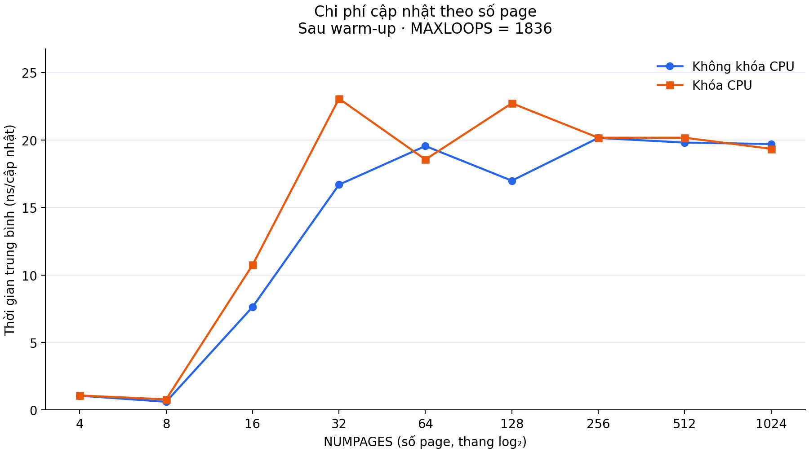

# Kết quả đo thời gian cập nhật mảng

Các bảng trước warm-up chưa xử lý chi phí lần truy cập đầu.

`ns/cập nhật = TIME / (MAXLOOPS × MAXN)`

## MAXLOOPS = 1836

| MAXN | Không khóa CPU: TIME (ns) | Khóa CPU: TIME (ns) | Không khóa: ns/cập nhật | Khóa: ns/cập nhật |
|---:|---:|---:|---:|---:|
| 4 | 4509 | 4439 | 0.614 | 0.604 |
| 16 | 10579 | 10880 | 0.360 | 0.370 |
| 32 | 41317 | 31750 | 0.703 | 0.540 |
| 64 | 41047 | 41307 | 0.349 | 0.352 |
| 128 | 163485 | 122559 | 0.696 | 0.522 |
| 256 | 163124 | 163213 | 0.347 | 0.347 |
| 512 | 353508 | 571734 | 0.376 | 0.608 |
| 1024 | 855362 | 830485 | 0.455 | 0.442 |

## Đo theo số page — MAXLOOPS = 1836

`ns/cập nhật = TIME / (1836 × NUMPAGES)`

| NUMPAGES | Khóa CPU: TIME (ns) | Không khóa CPU: TIME (ns) | Khóa: ns/cập nhật | Không khóa: ns/cập nhật |
|---:|---:|---:|---:|---:|
| 4 | 33453 | 26239 | 4.555 | 3.573 |
| 8 | 101539 | — | 6.913 | — |
| 16 | 308504 | — | 10.502 | — |
| 32 | 1138238 | — | 19.374 | — |
| 64 | 2665950 | — | 22.688 | — |
| 128 | Segmentation fault | — | — | — |
| 256 | — | — | — | — |
| 512 | — | — | — | — |
| 1024 | — | — | — | — |

—: chưa có số liệu.

## Sau warm-up — MAXLOOPS = 1836

`ns/cập nhật = TIME / (1836 × NUMPAGES)`

| NUMPAGES | Khóa CPU: TIME (ns) | Không khóa CPU: TIME (ns) | Khóa: ns/cập nhật | Không khóa: ns/cập nhật |
|---:|---:|---:|---:|---:|
| 4 | 7925 | 7794 | 1.079 | 1.061 |
| 8 | 11642 | 8977 | 0.793 | 0.611 |
| 16 | 315717 | 224228 | 10.747 | 7.633 |
| 32 | 1355071 | 980524 | 23.064 | 16.689 |
| 64 | 2180131 | 2297525 | 18.554 | 19.553 |
| 128 | 5340080 | 3992099 | 22.723 | 16.987 |
| 256 | 9480010 | 9471173 | 20.170 | 20.151 |
| 512 | 18960730 | 18621160 | 20.170 | 19.809 |
| 1024 | 36372939 | 37040093 | 19.347 | 19.702 |

**Nhận xét:** Chi phí tăng rõ khi vượt 8 page; từ 32–1024 page, hai chế độ dao động khoảng 17–23 ns/cập nhật. Khóa CPU không cho thời gian thấp hơn nhất quán.

## Cùng tổng số lượt cập nhật page

`LOOPS × NUMPAGES = 800000`; mỗi lượt cập nhật một phần tử trên một page.

| Chế độ | LOOPS | NUMPAGES | TIME (ns) | ns/cập nhật |
|---|---:|---:|---:|---:|
| Không khóa CPU | 100000 | 8 | 48772 | 0.061 |
| Không khóa CPU | 1000 | 800 | 17612243 | 22.015 |
| Khóa CPU | 100000 | 8 | 578697 | 0.723 |
| Khóa CPU | 1000 | 800 | 17022676 | 21.278 |

**Nhận xét:** Cùng 800000 lượt cập nhật, cấu hình 800 page vẫn chậm hơn 8 page; khi khóa CPU, chênh lệch khoảng 29,4 lần.

**Giải thích:** Với 8 page, chương trình tái sử dụng cùng các mapping và dữ liệu thường xuyên hơn. Với 800 page, chúng có thể bị thay thế trong TLB/cache trước khi được dùng lại, làm tăng chi phí truy cập. Cùng số lượt cập nhật không có nghĩa là cùng chi phí mỗi lượt. [OSTEP, Chương 19](https://pages.cs.wisc.edu/~remzi/OSTEP/vm-tlbs.pdf).

**Ghi chú:** Phép đo chưa tách riêng ảnh hưởng của TLB và cache. Mốc `48772 ns` tương ứng `0.061 ns/cập nhật`, cần đo lại để xác nhận.
