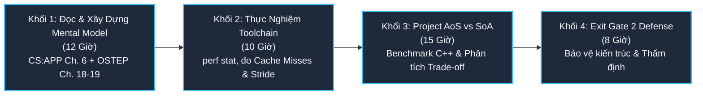

# 📘 PHASE 2: PHYSICAL LIMITS, DATA DYNAMICS & STORAGE TRADE-OFFS
## CẨM NANG HỌC TẬP VÀ THỰC NGHIỆM DUY NHẤT (THE DEFINITIVE STUDY GUIDE)

> **Vị Trí**: Phase 2 — Systems Architecture & Physical Foundations  
> **Khung Thời Gian Khóa Chặt**: 45 Giờ học chủ động  
> **Quan Hệ Phụ Thuộc Kế Thừa**:
> - Kế thừa từ **Phase 0**: Đo lường độ trễ bằng `std::chrono`, con trỏ C++, cấp phát bộ nhớ Stack vs Heap.
> - Kế thừa từ **Phase 1**: Không gian địa chỉ ảo (VAS), cơ chế phân trang (Paging), ngoại lệ Page Fault trong Copy-on-Write (COW).
> **Mục Tiêu Tối Thượng**: Làm chủ các quy luật vật lý của phần cứng (Hardware Constraints), phân tầng độ trễ (Memory Latency Hierarchy), đánh đổi bố cục dữ liệu (AoS vs SoA), áp lực bộ nhớ (Memory Pressure / Thrashing) và kiến trúc bộ đệm (Caching).

---

## MỤC LỤC
1. [Phân Bổ Thời Gian & Lộ Trình 45 Giờ](#1-phân-bổ-thời-gian--lộ-trình-45-giờ)
2. [Tài Liệu Nguồn Bắt Buộc & Phạm Vi Đọc Phẫu Thuật](#2-tài-liệu-nguồn-bắt-buộc--phạm-vi-đọc-phẫu-thuật)
3. [Trụ Cột 1: Cơ Học Phần Cứng & Phân Tầng Độ Trễ (Mechanical Sympathy & Latency Hierarchy)](#3-trụ-cột-1-cơ-học-phần-cứng--phân-tầng-độ-trễ-mechanical-sympathy--latency-hierarchy)
4. [Trụ Cột 2: Đánh Đổi Bố Cục Dữ Liệu: OOP (AoS) vs Data-Oriented (SoA)](#4-trụ-cột-2-đánh-đổi-bố-cục-dữ-liệu-oop-aos-vs-data-oriented-soa)
5. [Trụ Cột 3: Áp Lực Bộ Nhớ Ảo, Page Faults & Hiện Tượng Thrashing](#5-trụ-cột-3-áp-lực-bộ-nhớ-ảo-page-faults--hiện-tượng-thrashing)
6. [Trụ Cột 4: Kiến Trúc Bộ Đệm (Caching Strategies & Invalidation)](#6-trụ-cột-4-kiến-trúc-bộ-đệm-caching-strategies--invalidation)
7. [Thực Nghiệm Toolchain: Tự Viết & Đo Đạc Cơ Chế Bằng C++ (10 Giờ)](#7-thực-nghiệm-toolchain-tự-viết--đo-đạc-cơ-chế-bằng-c-10-giờ)
8. [Dự Án Cốt Mốc: Data-Oriented Micro-Benchmark trong C++ (15 Giờ)](#8-dự-án-cốt-mốc-data-oriented-micro-benchmark-trong-c-15-giờ)
9. [Bộ Tiêu Chuẩn & Câu Hỏi Thẩm Định Exit Gate 2 (8 Giờ)](#9-bộ-tiêu-chuẩn--câu-hỏi-thẩm-định-exit-gate-2-8-giờ)

---

<a id="1-phân-bổ-thời-gian--lộ-trình-45-giờ"></a>
## 1. Phân Bổ Thời Gian & Lộ Trình 45 Giờ

Lộ trình Phase 2 được thiết kế gói gọn trong **45 giờ**, chia làm 4 khối hoạt động chuẩn mực:



---

<a id="2-tài-liệu-nguồn-bắt-buộc--phạm-vi-đọc-phẫu-thuật"></a>
## 2. Tài Liệu Nguồn Bắt Buộc & Phạm Vi Đọc Phẫu Thuật

Chỉ đọc đúng các chương/mục mục tiêu sau (tổng cộng dưới 40 trang):

| Tài liệu chuẩn mực | Phạm vi đọc bắt buộc | Trọng tâm cần nắm |
| :--- | :--- | :--- |
| **CS:APP3e (Bryant & O'Hallaron)** | • **Chương 6**: *The Memory Hierarchy*<br>  - Mục 6.1: Storage Technologies (SRAM, DRAM, Disk).<br>  - Mục 6.2: Locality (Spatial vs Temporal).<br>  - Mục 6.3: Memory Hierarchy.<br>  - Mục 6.4: Cache Memories (Cache lines, hit/miss). | • Cơ chế Cache Line 64 bytes.<br>• Tại sao truy cập theo hàng nhanh hơn theo cột trong C/C++.<br>• Cách CPU nạp dữ liệu từ RAM lên L1/L2/L3. |
| **OSTEP (Arpaci-Dusseau)** | • **Chương 18**: *Paging: Introduction*<br>• **Chương 19**: *Paging: Faster Translations (TLBs)* | • Page 4KB, VPN (Virtual Page Number) ➔ PFN (Physical Frame Number).<br>• Vai trò của TLB cache và chi phí khi TLB miss. |
| **Interactive Resource** | • *Latency Numbers Every Programmer Should Know* (Colin Scott) | • Bảng độ trễ vật lý: L1 (~1ns) vs RAM (~100ns) vs NVMe (~10-50µs) vs Network (~100ms). |

> ❌ **Phần BỎ QUA trong Phase 2**:  
> Bỏ qua Ch. 3 (Assembly vi mô), Ch. 4 (Thiết kế chip xử lý), Ch. 9 (Tự viết bộ cấp phát malloc từ đầu). Không học thuộc bảng bitmask phân trang của phần cứng MMU.

---

<a id="3-trụ-cột-1-cơ-học-phần-cứng--phân-tầng-độ-trễ-mechanical-sympathy--latency-hierarchy"></a>
## 3. Trụ Cột 1: Cơ Học Phần Cứng & Phân Tầng Độ Trễ (Mechanical Sympathy & Latency Hierarchy)

### 3.1. Nghịch Lý Tốc Độ CPU vs Tốc Độ Bộ Nhớ (The Memory Wall)
* Trong suốt 40 năm qua, tốc độ tính toán của CPU tăng theo cấp số nhân (chu kỳ xung nhịp ~0.3ns – 1ns), nhưng tốc độ truy xuất DRAM (RAM) chỉ cải thiện rất chậm (~50ns – 100ns).
* **Khoảng cách vật lý**: Nếu CPU cần lấy dữ liệu trực tiếp từ RAM, nó phải **đứng im (Stall) hàng trăm chu kỳ CPU** để chờ dữ liệu bay qua Memory Bus.
* **Giải pháp phần cứng**: Hệ thống CPU Cache nhiều tầng (SRAM) tích hợp ngay trên đế chip:
  - **L1 Cache**: ~0.5 – 1 ns (~4 chu kỳ CPU), dung lượng nhỏ (32KB – 64KB per core), siêu nhanh. Tách riêng L1i (Instruction) và L1d (Data).
  - **L2 Cache**: ~3 – 4 ns (~12 chu kỳ CPU), dung lượng 256KB – 1MB per core.
  - **L3 Cache (LLC - Last Level Cache)**: ~10 – 15 ns (~40 chu kỳ CPU), dung lượng 8MB – 64MB, chia sẻ chung giữa các cores.
  - **Main Memory (DRAM)**: ~60 – 100 ns (~200 chu kỳ CPU).
  - **NVMe SSD**: ~10 – 50 µs (~100.000 chu kỳ CPU).
  - **Cross-Datacenter Network**: ~100 – 150 ms (~300.000.000 chu kỳ CPU).

```
+-------------------------------------------------------+  Tốc độ: ~1 ns
| L1 Cache (32KB - 64KB per core)                       |  Dung lượng: Siêu nhỏ
+-------------------------------------------------------+
| L2 Cache (256KB - 1MB per core)                       |  Tốc độ: ~3-4 ns
+-------------------------------------------------------+
| L3 Cache / LLC (Shared, 8MB - 64MB)                   |  Tốc độ: ~10-15 ns
+-------------------------------------------------------+
| Main Memory (DRAM, 16GB - 256GB)                      |  Tốc độ: ~60-100 ns (Trễ gấp 100x L1!)
+-------------------------------------------------------+
| NVMe SSD / Storage                                    |  Tốc độ: ~10-50 µs (Trễ gấp 50.000x L1!)
+-------------------------------------------------------+
```

### 3.2. Cache Line (64 Bytes): Đơn Vị Giao Dịch Tối Thiểu
* Phần cứng **không bao giờ đọc 1 byte hay 4 byte lẻ từ RAM**.
* Mỗi khi CPU cần đọc một biến từ RAM, phần cứng MMU và Memory Controller nạp **nguyên một khối liền kề 64 bytes (Cache Line)** vào L1/L2/L3 Cache!
* **Spatial Locality (Cục bộ không gian)**: Nếu bạn truy cập ô nhớ `A[i]`, các ô nhớ lân cận `A[i+1]`, `A[i+2]` đã được tự động nạp sẵn vào Cache Line 64B đó. Lần đọc tiếp theo sẽ trúng L1 Cache (Cache Hit) với chi phí chỉ ~1ns!
* **Temporal Locality (Cục bộ thời gian)**: Nếu bạn vừa truy cập ô nhớ `A[i]`, rất có thể bạn sẽ tái sử dụng nó trong tương lai gần. Dữ liệu sẽ được giữ lại trong L1 Cache.

### 3.3. Hiểm Họa Của "Pointer Chasing" (Truy Cập Con Trỏ Ngẫu Nhiên)
* Các cấu trúc dữ liệu kinh điển dựa trên con trỏ (Linked List, Binary Search Tree, Node-based Hash Map):
  - Mỗi node được cấp phát ngẫu nhiên trên Heap qua `malloc()` / `new`.
  - Node A nằm ở địa chỉ `0x1000`, trỏ tới Node B ở `0x8000`, trỏ tới Node C ở `0x2500`.
  - **Hậu quả phần cứng**: Mỗi lần duyệt qua con trỏ `node = node->next`, CPU phải đợi nạp một Cache Line 64B hoàn toàn mới từ RAM (~100ns)! Trong Cache Line đó chỉ có 1 node hữu ích, 56 bytes còn lại là rác bị bỏ phí.
  - *Thuật toán $O(N)$ trên Linked List có thể chạy CHẬM HƠN GẤP 10 LẦN so với duyệt mảng tuần tự `std::vector`*, bởi vì CPU liên tục bị đói dữ liệu (Memory Stalls).

---

<a id="4-trụ-cột-2-đánh-đổi-bố-cục-dữ-liệu-oop-aos-vs-data-oriented-soa"></a>
## 4. Trụ Cột 2: Đánh Đổi Bố Cục Dữ Liệu: OOP (AoS) vs Data-Oriented (SoA)

### 4.1. Khái Niệm AoS (Array of Structures) vs SoA (Structure of Arrays)
* **AoS (Array of Structures — Tư duy OOP truyền thống)**:
  - Gom toàn bộ thuộc tính của một thực thể vào 1 struct/class, sau đó tạo mảng các thực thể đó.
  ```cpp
  struct EntityAoS {
      float x, y, z;      // 12 bytes
      int id;             // 4 bytes
      char name[32];      // 32 bytes
      int health;         // 4 bytes
  }; // Tổng kích thước: 52 -> 56 bytes (do padding căn chỉnh)

  std::vector<EntityAoS> entities(1'000'000);
  ```
  - *Bố cục trong RAM*:  
    `[Entity 0: x, y, z, id, name, health] [Entity 1: x, y, z, id, name, health] ...`

* **SoA (Structure of Arrays — Tư duy Data-Oriented / Columnar)**:
  - Tách rời từng thuộc tính thành các mảng liền kề độc lập.
  ```cpp
  struct EntitySoA {
      std::vector<float> x;
      std::vector<float> y;
      std::vector<float> z;
      std::vector<int> id;
      std::vector<std::string> name;
      std::vector<int> health;
  };
  ```
  - *Bố cục trong RAM*:  
    `[x0, x1, x2, x3, x4, ...] [y0, y1, y2, y3, ...] [id0, id1, ...]`

### 4.2. Phân Tích Đánh Đổi Kiến Trúc (Architectural Trade-offs)
Giả sử bài toán cần duyệt 1.000.000 thực thể để **cập nhật tọa độ `x` (ví dụ: `x += 1.0f`)**:
* **Với AoS**:
  - Để lấy `entities[i].x` (4 bytes), CPU nạp nguyên 1 Cache Line 64B từ RAM.
  - Trong 64 bytes đó, chỉ có 4 bytes `x` là có ích! 60 bytes còn lại chứa `name`, `id`, `health` hoàn toàn không dùng đến trong vòng lặp này nhưng vẫn chiếm chỗ trong L1 Cache.
  - **Mật độ hữu ích của Cache chỉ đạt ~6.25%!** Băng thông bus bộ nhớ bị bão hòa bởi dữ liệu rác.
* **Với SoA**:
  - Toàn bộ các giá trị `x` nằm liền kề nhau: `x[0], x[1], x[2], ...`.
  - Một Cache Line 64B nạp được chính xác **16 số `float` liên tiếp** ($64 / 4 = 16$).
  - **Mật độ hữu ích của Cache đạt 100%!** CPU xử lý mượt mà, bộ nạp trước (Hardware Prefetcher) dễ dàng dự đoán luồng dữ liệu.

| Tiêu chí | AoS (Array of Structures) | SoA (Structure of Arrays) |
| :--- | :--- | :--- |
| **Tư duy thiết kế** | Hướng đối tượng (OOP), thực thể độc lập | Hướng dữ liệu (Data-Oriented), Columnar Storage |
| **Công thái học (Ergonomics)** | Rất tiện cho dev (`entity.update()`) | Khó viết code hơn, quản lý nhiều mảng song song |
| **Truy cập 1 thực thể đầy đủ** | Tối ưu (tất cả trường nằm chung 1 chỗ) | Kém (phải nhảy qua 5 mảng khác nhau) |
| **Xử lý hàng loạt (Batch Processing)**| Rất kém, lãng phí Cache Lines | **Tối ưu vượt trội (2x – 5x throughput)** |
| **Ứng dụng thực tế** | CRUD nghiệp vụ, API request đơn lẻ | Database OLAP (ClickHouse, Parquet), Game Engines, AI/ML pipelines |

---

<a id="5-trụ-cột-3-áp-lực-bộ-nhớ-ảo-page-faults--hiện-tượng-thrashing"></a>
## 5. Trụ Cột 3: Áp Lực Bộ Nhớ Ảo, Page Faults & Hiện Tượng Thrashing

### 5.1. Cơ Chế Phân Trang (Paging) & TLB
* Không gian địa chỉ ảo (VAS) của tiến trình được chia thành các khối cố định gọi là **Trang (Virtual Page - 4 KB)**.
* Bộ nhớ RAM vật lý được chia thành các khung trang (**Physical Frame - 4 KB**).
* **Bảng phân trang (Page Table)**: Do Kernel quản lý, lưu ánh xạ: `Virtual Page Number (VPN) ➔ Physical Frame Number (PFN)`.
* **TLB (Translation Lookaside Buffer)**: Bộ đệm phần cứng siêu tốc trên CPU lưu các bản dịch VPN ➔ PFN gần nhất.
  - **TLB Hit**: Dịch địa chỉ tức thì (< 1ns).
  - **TLB Miss**: CPU phải duyệt bảng phân trang trong RAM (Page Table Walk), tốn thêm vài chục chu kỳ CPU.

### 5.2. Minor Page Fault vs Major Page Fault
Khi tiến trình truy cập một địa chỉ bộ nhớ ảo hợp lệ nhưng phần cứng MMU chưa tìm thấy khung trang vật lý tương ứng trong Page Table, MMU kích hoạt ngoại lệ **Page Fault**:
1. **Minor Page Fault (Soft Page Fault)**:
   - Trang bộ nhớ thực chất **đã nằm trong RAM vật lý** nhưng chưa được ánh xạ vào Page Table của tiến trình (ví dụ: Demand Paging lần đầu ghi vào vùng nhớ vừa cấp phát, hoặc trang chia sẻ Copy-on-Write).
   - Kernel chỉ cần cập nhật lại Page Table. **Độ trễ rất nhỏ (~vài micro-giây)**.
2. **Major Page Fault (Hard Page Fault)**:
   - Dữ liệu của trang **không có trong RAM**, mà đang nằm trên ổ đĩa (do bị đẩy sang phân vùng Swap, hoặc đang nạp từ file trên đĩa qua `mmap`).
   - Kernel bắt buộc phải phát lệnh I/O đọc đĩa để nạp trang 4KB vào RAM, sau đó mới cập nhật Page Table.
   - **Độ trễ tăng vọt từ nano-giây lên milli-giây (chậm gấp 100.000 đến 1.000.000 lần)!**

### 5.3. Hiện Tượng Sụp Đổ Hiệu Năng: Thrashing (Tráo Đổi Trang Liên Tục)
* **Working Set**: Tập hợp các trang bộ nhớ mà tiến trình thực sự cần truy cập thường xuyên trong một khoảng thời gian.
* **Hiện tượng Thrashing**:
  - Khi tổng Working Set của các tiến trình vượt quá dung lượng RAM vật lý có sẵn.
  - Kernel buộc phải đẩy trang của tiến trình A ra đĩa (Swap out) để lấy chỗ nạp trang của tiến trình B (Swap in). Ngay sau đó, tiến trình A cần chạy lại, Kernel lại phải đẩy trang B ra để nạp A vào!
  - **Hệ quả**: Toàn bộ hệ thống bị nghẽn cứng ở I/O đĩa. Tỉ lệ sử dụng CPU giảm về gần 0% vì mọi luồng đều bị blocked chờ đọc đĩa. Đèn ổ đĩa sáng liên tục, hệ thống đơ hoàn toàn.

### 5.4. Cơ Chế Tự Vệ Thô Bạo: OOM Killer (Out-Of-Memory Killer)
* Khi cả RAM vật lý lẫn Swap đều cạn kiệt, hệ thống không thể cấp phát thêm dù chỉ 1 trang nhớ.
* Kernel kích hoạt cơ chế tự vệ cuối cùng: **OOM Killer**.
* Thuật toán OOM Killer duyệt toàn bộ tiến trình, tính toán điểm số phạt (`oom_score` dựa trên dung lượng RAM chiếm dụng và mức độ quan trọng `oom_score_adj`). Tiến trình có điểm phạt cao nhất sẽ bị gửi ngay tín hiệu **`SIGKILL` (giết tức thì)** để giải phóng RAM cứu sống hệ điều hành.

---

<a id="6-trụ-cột-4-kiến-trúc-bộ-đệm-caching-strategies--invalidation"></a>
## 6. Trụ Cột 4: Kiến Trúc Bộ Đệm (Caching Strategies & Invalidation)

### 6.1. Ba Mẫu Thiết Kế Cache Cơ Bản
1. **Cache-Aside (Lazy Loading)**:
   - Ứng dụng đọc: Đọc Cache trước. Nếu Hit ➔ trả về. Nếu Miss ➔ đọc Storage/DB ➔ ghi ngược vào Cache ➔ trả về.
   - *Ưu điểm*: Chỉ cache dữ liệu thực sự được đọc; node Cache sập thì ứng dụng vẫn chạy (chỉ chậm hơn).
   - *Nhược điểm*: Phạt độ trễ ở lần đọc đầu tiên (Cache Miss).
2. **Write-Through**:
   - Khi ghi dữ liệu: Ứng dụng ghi vào Cache, và Cache đồng bộ ghi ngay lập tức xuống Storage trước khi báo thành công.
   - *Ưu điểm*: Dữ liệu trong Cache luôn mới nhất, không bao giờ mất dữ liệu.
   - *Nhược điểm*: Độ trễ ghi cao vì phải đợi cả 2 tầng hoàn tất.
3. **Write-Back (Write-Behind)**:
   - Khi ghi: Ứng dụng chỉ ghi vào Cache và nhận phản hồi thành công ngay lập tức. Sau đó, Cache gom dữ liệu và ghi bất đồng bộ xuống Storage theo chu kỳ.
   - *Ưu điểm*: Tốc độ ghi siêu nhanh.
   - *Nhược điểm*: Rủi ro mất mát dữ liệu nếu node Cache sập trước khi kịp xả dữ liệu xuống đĩa.

### 6.2. Cạm Bẫy Cache Invalidation & Hiệu Ứng Thundering Herd
* **Cache Invalidation**: *"Chỉ có hai điều khó trong Khoa học Máy tính: đặt tên biến và hủy hợp lệ bộ đệm (cache invalidation)"* — Phil Karlton.
* **Stale Data (Dữ liệu cũ)**: Bản ghi trong DB bị thay đổi nhưng Cache chưa bị xóa, khiến client đọc phải dữ liệu sai lệch.
* **Thundering Herd (Cache Stampede)**: Một key phổ biến (hot key) bị hết hạn (TTL expired) đúng lúc có 10.000 requests cùng ập tới. Cả 10.000 requests đều thấy Cache Miss và cùng lúc dồn dập query thẳng vào Database ➔ Database bị quá tải và sụp đổ ngay lập tức.  
  *Giải pháp*: Sử dụng Mutex Lock ở tầng ứng dụng (chỉ cho 1 request đi xuống DB nạp lại cache, các request khác chờ).

---

<a id="7-thực-nghiệm-toolchain-tự-viết--đo-đạc-cơ-chế-bằng-c-10-giờ"></a>
## 7. Thực Nghiệm Toolchain: Tự Viết & Đo Đạc Cơ Chế Bằng C++ (10 Giờ)

Dành **10 giờ** để tự tay viết 3 chương trình C++ nhỏ, biên dịch bằng `g++ -O2` trên Linux/WSL2 và dùng `perf` để quan sát trực tiếp các cơ chế phần cứng:

---

### Lab 2.1: Đo lường Truy Cập Tuần Tự vs Bước Nhảy Ngẫu Nhiên (`stride_benchmark.cpp`)
* **Cơ chế cần hiểu**: Spatial Locality và Cache Line 64B. Một Cache Line nạp được 16 số nguyên 4-byte (`sizeof(int) = 4`). Nếu duyệt với bước nhảy (Stride) = 1, cứ 16 phần tử mới bị 1 Cache Miss. Nếu bước nhảy Stride = 16 (nhảy 64 bytes), **mỗi phần tử duyệt qua đều dính 1 Cache Miss mới!**
* **Tự triển khai bằng C++ (`Phase_2/src/lab2_stride.cpp`)**:
  ```cpp
  #include <iostream>
  #include <vector>
  #include <chrono>

  const size_t ARRAY_SIZE = 64 * 1024 * 1024; // 64 triệu int (~256 MB, vượt xa L3 Cache)

  void run_stride(const std::vector<int>& arr, size_t stride) {
      long long sum = 0;
      auto start = std::chrono::high_resolution_clock::now();
      
      // Duyệt mảng theo bước nhảy stride
      for (size_t i = 0; i < arr.size(); i += stride) {
          sum += arr[i];
      }
      
      auto end = std::chrono::high_resolution_clock::now();
      std::chrono::duration<double, std::milli> elapsed = end - start;
      std::cout << "Stride: " << stride << " | Time: " << elapsed.count() << " ms | Sum: " << sum << std::endl;
  }

  int main(int argc, char* argv[]) {
      size_t stride = (argc > 1) ? std::stoull(argv[1]) : 1;
      std::vector<int> data(ARRAY_SIZE, 1);
      run_stride(data, stride);
      return 0;
  }
  ```
* **Quan sát / Đo đạc bằng công cụ**:
  Biên dịch với `-O2`:
  ```bash
  g++ -O2 Phase_2/src/lab2_stride.cpp -o lab2_stride
  perf stat -e L1-dcache-load-misses,cycles,instructions ./lab2_stride 1
  perf stat -e L1-dcache-load-misses,cycles,instructions ./lab2_stride 16
  ```
* **Tiêu chí xác nhận**: So sánh kết quả `perf stat`: Khi chạy với `stride 16`, số lượng `L1-dcache-load-misses` tăng vọt và thời gian thực thi trên mỗi phần tử tăng gấp nhiều lần so với `stride 1`.

---

### Lab 2.2: So Sánh Bố Cục Dữ Liệu AoS vs SoA trong C++ (`lab2_aos_vs_soa.cpp`)
* **Cơ chế cần hiểu**: Cấu trúc AoS làm loãng Cache Line khi chỉ tính toán trên 1 trường dữ liệu. SoA tối đa hóa mật độ dữ liệu hữu ích trong Cache Line.
* **Tự triển khai bằng C++ (`Phase_2/src/lab2_aos_vs_soa.cpp`)**:
  ```cpp
  #include <iostream>
  #include <vector>
  #include <chrono>

  const size_t NUM_PARTICLES = 5'000'000;

  // Mô hình AoS (OOP)
  struct ParticleAoS {
      float x, y, z;
      int id;
      char tag[32]; // Dữ liệu phụ làm phình kích thước lên 48 bytes
  };

  // Mô hình SoA (Data-Oriented)
  struct ParticleSoA {
      std::vector<float> x;
      std::vector<float> y;
      std::vector<float> z;
      std::vector<int> id;
  };

  int main() {
      // 1. Benchmark AoS
      std::vector<ParticleAoS> aos(NUM_PARTICLES);
      for (size_t i = 0; i < NUM_PARTICLES; ++i) aos[i].x = 1.0f;

      auto start_aos = std::chrono::high_resolution_clock::now();
      float sum_aos = 0;
      for (size_t i = 0; i < NUM_PARTICLES; ++i) {
          sum_aos += aos[i].x;
      }
      auto end_aos = std::chrono::high_resolution_clock::now();
      std::chrono::duration<double, std::milli> aos_time = end_aos - start_aos;

      // 2. Benchmark SoA
      ParticleSoA soa;
      soa.x.resize(NUM_PARTICLES, 1.0f);

      auto start_soa = std::chrono::high_resolution_clock::now();
      float sum_soa = 0;
      for (size_t i = 0; i < NUM_PARTICLES; ++i) {
          sum_soa += soa.x[i];
      }
      auto end_soa = std::chrono::high_resolution_clock::now();
      std::chrono::duration<double, std::milli> soa_time = end_soa - start_soa;

      std::cout << "AoS Time: " << aos_time.count() << " ms (Sum: " << sum_aos << ")" << std::endl;
      std::cout << "SoA Time: " << soa_time.count() << " ms (Sum: " << sum_soa << ")" << std::endl;
      std::cout << "Throughput Tăng: " << (aos_time.count() / soa_time.count()) << "x" << std::endl;
      return 0;
  }
  ```
* **Quan sát / Đo đạc bằng công cụ**:
  ```bash
  g++ -O2 Phase_2/src/lab2_aos_vs_soa.cpp -o lab2_aos_vs_soa
  perf stat -e L1-dcache-load-misses,cycles ./lab2_aos_vs_soa
  ```
* **Tiêu chí xác nhận**: SoA chạy nhanh hơn ít nhất **2x – 4x** so với AoS dù cùng số phép cộng số thực `float`, và `perf stat` chỉ ra AoS tạo ra nhiều cache misses hơn đáng kể.

---

### Lab 2.3: Quan Sát Page Faults & Working Set
* **Cơ chế cần hiểu**: Khác biệt giữa Minor Page Fault (cấp phát trang mới trong RAM) và Major Page Fault.
* **Tự triển khai bằng C++ (`Phase_2/src/lab2_page_fault.cpp`)**:
  ```cpp
  #include <iostream>
  #include <vector>
  #include <cstring>

  int main() {
      const size_t SIZE = 100 * 1024 * 1024; // 100 MB
      std::cout << "Cấp phát 100 MB bộ nhớ..." << std::endl;
      char* mem = new char[SIZE];

      std::cout << "Bắt đầu chạm vào từng trang 4KB để kích hoạt Demand Paging..." << std::endl;
      for (size_t i = 0; i < SIZE; i += 4096) {
          mem[i] = 'A'; // Kích hoạt 1 Minor Page Fault cho mỗi trang 4KB
      }
      
      delete[] mem;
      return 0;
  }
  ```
* **Quan sát / Đo đạc bằng công cụ**:
  Sử dụng lệnh `/usr/bin/time -v`:
  ```bash
  g++ -O2 Phase_2/src/lab2_page_fault.cpp -o lab2_page_fault
  /usr/bin/time -v ./lab2_page_fault
  ```
* **Tiêu chí xác nhận**: Trong output của `/usr/bin/time -v`:
  - `Minor (reclaiming a frame) page faults`: xấp xỉ $\approx 25.600$ lần ($100 \text{ MB} / 4 \text{ KB} = 25.600$).
  - `Major (requiring I/O) page faults`: bằng `0` (vì không phải đọc từ đĩa).

---

<a id="8-dự-án-cốt-mốc-data-oriented-micro-benchmark-trong-c-15-giờ"></a>
## 8. Dự Án Cốt Mốc: Data-Oriented Micro-Benchmark trong C++ (15 Giờ)

* **Thời gian thực hiện**: 15 giờ.
* **Quy mô triển khai**: Tự tay viết một file mã nguồn C++ độc lập khoảng **70–80 dòng code** tại `Phase_2/src/project2_benchmark.cpp`.

### 8.1. Mục Tiêu Dự Án
Xây dựng một micro-benchmark hoàn chỉnh đo lường sự đánh đổi hiệu năng giữa mô hình OOP truyền thống (AoS) và mô hình Data-Oriented (SoA) khi xử lý bài toán **Lọc và Cập nhật thuộc tính của 10.000.000 hạt vật lý (Particles)**:
- Mỗi hạt có: `x, y, z (float)`, `vx, vy, vz (float)`, `id (int)`, `active (bool)`, `extra_metadata (char[48])`.
- Bài toán: Chỉ cập nhật vị trí các hạt đang `active`: `x += vx * dt; y += vy * dt; z += vz * dt;`.

### 8.2. Break-Check Bắt Buộc (Kích Hoạt & Chứng Minh)
1. **Thí nghiệm 1 (Kích thước Payload)**: Tăng trường `extra_metadata` từ 48 bytes lên 128 bytes trong struct AoS ➔ Biên dịch lại và chạy `perf stat`.
   - **Hiện tượng**: Thời gian chạy của AoS tăng vọt, trong khi thời gian chạy của SoA giữ nguyên tuyệt đối không đổi!
   - **Giải thích**: SoA tách riêng `extra_metadata` sang một mảng riêng không đụng tới; AoS buộc CPU phải nạp cả mảng rác 128B vào cache line.
2. **Thí nghiệm 2 (Compiler Optimization Flag)**: So sánh kết quả khi biên dịch với `g++ -O0` vs `g++ -O2` vs `g++ -O3 -mavx2` (Vectorization SIMD).

---

<a id="9-bộ-tiêu-chuẩn--câu-hỏi-thẩm-định-exit-gate-2-8-giờ"></a>
## 9. Bộ Tiêu Chuẩn & Câu Hỏi Thẩm Định Exit Gate 2 (8 Giờ)

Exit Gate 2 đánh giá toàn diện năng lực trên 4 chiều:

### 1. Khả Năng Giải Thích Cơ Chế (Explain)
* Trình bày cơ chế nạp Cache Line 64B của phần cứng CPU. Tại sao một thuật toán duyệt mảng 2D theo cột `A[col][row]` trong C/C++ lại có thể chậm hơn gấp 5 lần so với duyệt theo hàng `A[row][col]` dù tổng số phép toán số học là giống hệt nhau?

### 2. Tự Viết & Chỉnh Sửa Code C++ (Implement)
* Mở mã nguồn `project2_benchmark.cpp` và thực hiện trực tiếp: Chuyển đổi một struct AoS mới sang dạng SoA, viết vòng lặp xử lý và đo thời gian thực thi bằng `std::chrono` ngay trong 10 phút.

### 3. Dự Đoán Hành Vi & Đo Đạc (Predict & Measure)
* Dự đoán chỉ số `L1-dcache-load-misses` và `instructions per cycle (IPC)` khi tăng kích thước struct trong AoS. Dùng `perf stat` đo đạc thực tế để chứng minh giả thuyết.

### 4. Phân Tích Đánh Đổi Kiến Trúc (Trade-off Analysis)
* Đóng vai trò System Architect trả lời câu hỏi: *"Nếu hệ thống là một dịch vụ Web API xử lý 1 request tạo mới 1 đơn hàng (Order) tại một thời điểm, ta nên dùng AoS hay SoA? Tại sao? Khi nào thì bắt buộc phải chuyển sang kiến trúc SoA?"*  
  $\rightarrow$ **Tiêu chuẩn đạt**: Nhận diện rõ: Single Entity CRUD thì AoS thuận tiện và tối ưu vì truy cập toàn bộ thuộc tính cùng lúc; Chỉ khi xử lý dữ liệu lớn (Batch Processing, Analytics, ETL, High-Throughput Pipeline) thì SoA mới phát huy sức mạnh vượt trội.
