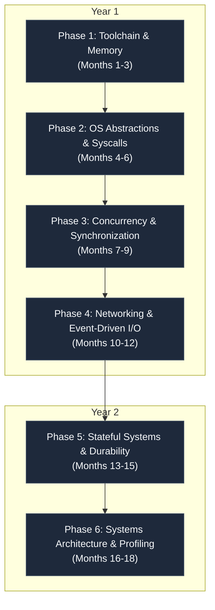

# Systems Engineering

This repository serves as a technical log, experimentation bench, and evidence of deliberate practice across an 18-month Core Systems Engineering Curriculum. 

It is not a collection of course notes, syntax cheatsheets, tutorial follow-alongs, or framework prototypes. Every entry, implementation, and benchmark here is designed to isolate and understand the fundamental mechanics of computer systems: resource ownership, state transitions, concurrency primitives, OS abstractions, network communication, and failure modes under stress.

---

## Current Status

| Dimension | Details |
| :--- | :--- |
| **Active Phase** | Phase 1: Toolchain, Memory Layout, and C++ Systems Primitives |
| **Current Focus** | Virtual memory translation, pointer arithmetic, custom arena allocators |
| **Tooling Active** | GCC / Clang, CMake, GDB, Valgrind, AddressSanitizer (ASan) |
| **Verification Gate** | Zero memory leaks, reproducible ASan diagnostics, determinism across builds |
| **Start Date** | October 2026 |
| **Target Completion** | April 2028 (18-Month Target) |

---

## Why This Exists

Modern software engineering frequently abstracts away hardware realities: allocation latency, cache hierarchies, context switches, kernel transitions, and non-deterministic network I/O. While abstractions provide rapid development cycles, building resilient, high-performance software requires understanding what happens when those abstractions leak or fail.

The objectives of this repository are:
1. **Document Deliberate Practice:** Move beyond surface-level API usage to internalize the operational mechanics of software.
2. **Cultivate Engineering Mental Models:** Ground software design in hardware realities (CPU caches, MMU, page tables, ring buffers, network stacks).
3. **Establish Rigorous Debugging Discipline:** Treat debugging not as trial-and-error guesswork, but as the systematic application of the scientific method to software state.
4. **Produce Verifiable Artifacts:** Pair theoretical knowledge with concrete implementations, automated stress tests, profiling benchmarks, and root-cause post-mortems.

---

## Learning Principles

### 1. Mental Models Over Memorization
APIs and framework syntaxes churn; the physics of hardware and the mathematical constraints of distributed state do not. Priority is given to understanding:
- **Ownership:** Who allocates, who mutates, who frees, and who synchronizes.
- **State & Invariants:** What states are valid, what transitions are permissible, and how invariants are preserved across failure boundaries.
- **Communication:** How bytes move across processes, threads, and networks (copying overhead, buffering, framing, and backpressure).
- **Failure:** How systems behave when disks stall, packets drop, allocations fail, or threads deadlock.
- **Performance:** Hardware-sympathetic design, cache line alignment, memory bandwidth, branch prediction, and algorithmic complexity.

### 2. The Build → Break → Observe → Fix Loop
Learning occurs at the edge of failure. Every implementation follows a continuous cycle:
1. **Build:** Implement the core abstraction from first principles using standard tooling.
2. **Break:** Subject the implementation to adversarial inputs, concurrency races, memory pressure, and fault injection.
3. **Observe:** Inspect memory dumps, system call traces, CPU counters, and sanitizer reports (`gdb`, `perf`, `strace`, `valgrind`, `sanitizers`).
4. **Fix:** Re-architect to enforce invariant safety, prevent resource exhaustion, or eliminate race conditions.

### 3. Debugging as the Scientific Method
Bugs are deviations between the mental model and the execution model. Every debugging session follows:
- **Observation:** Characterize the unexpected symptom (e.g., SEGFAULT, data corruption, latency spike).
- **Hypothesis:** Formulate a falsifiable statement explaining the root cause based on systems fundamentals.
- **Instrumentation:** Add assertions, hardware watchpoints, tracepoints, or minimal reproductions to isolate the fault without mutating the observed behavior.
- **Verification:** Prove the fix by confirming that the reproduction test fails before the patch and passes cleanly under stress afterward.

### 4. Durable Fundamentals Before Specialization
Prioritize timeless engineering domains: memory models, assembly conventions, POSIX system calls, I/O multiplexing, and lock-free synchronization, prior to consuming high-level distributed systems frameworks or domain-specific tools.

---

## 18-Month Curriculum Phases

The curriculum is structured into six consecutive 3-month phases. Each phase culminates in a benchmarked milestone project accompanied by empirical test suites and debugging write-ups.

```
Months:  01-03        04-06        07-09        10-12        13-15        16-18
Phases: [Phase 1] -> [Phase 2] -> [Phase 3] -> [Phase 4] -> [Phase 5] -> [Phase 6]
Focus:   Toolchain    OS & Sys     Concurrency  Networking   Stateful     Architecture
         & Memory     Calls        & Atomics    & I/O Mux    Storage      & Scale
```

### Phase 1: Toolchain, Memory, and Modern C++ Foundations (Months 1–3)
- **Focus:** Compilation pipeline, ELF binaries, linkers, memory layout (stack, heap, BSS, text), pointer semantics, RAII, value categories, and custom memory management.
- **Tools:** GCC, Clang, CMake, Make, `objdump`, `readelf`, `nm`, Valgrind, AddressSanitizer.
- **Core Concepts:** Alignment, padding, cache lines, virtual address space, arena/slab allocators, move semantics, zero-overhead abstractions.
- **Milestone Project:** Deterministic memory pool allocator and custom string/vector implementations with custom allocator support and zero heap fragmentation.

### Phase 2: Operating Systems & System Call Abstractions (Months 4–6)
- **Focus:** The kernel-user space boundary, system calls, virtual memory, process lifecycle, signal handling, and file system primitives.
- **Tools:** `strace`, `ltrace`, GDB, POSIX APIs, `/proc` and `/sys` inspection.
- **Core Concepts:** Context switching, page faults, `mmap`, copy-on-write, file descriptors, file table vs. inode table, inter-process communication (pipes, shared memory, domain sockets).
- **Milestone Project:** Minimal UNIX-style process supervisor and custom POSIX shell supporting job control, piping, redirection, and signal propagation.

### Phase 3: Concurrency, Multithreading, and Synchronization (Months 7–9)
- **Focus:** Hardware memory models, cache coherence protocols (MESI), atomic operations, mutual exclusion primitives, and synchronization bugs.
- **Tools:** ThreadSanitizer (TSan), Helgrind, GDB thread inspection, `perf`.
- **Core Concepts:** Race conditions, deadlocks, livelocks, priority inversion, memory barriers, sequential consistency vs. acquire-release semantics, false sharing.
- **Milestone Project:** High-throughput, bounded multi-producer multi-consumer (MPMC) lock-free ring buffer and thread pool with work-stealing capabilities.

### Phase 4: Networking Protocols & I/O Multiplexing (Months 10–12)
- **Focus:** The network stack (OSI/TCP-IP), socket programming, readiness/completion models, non-blocking I/O, and framing.
- **Tools:** `tcpdump`, Wireshark, `netstat`/`ss`, `nc`, `curl`, `wrk`.
- **Core Concepts:** TCP state machine (handshake, teardown, TIME_WAIT), flow control, congestion control, head-of-line blocking, event notification (`epoll`, `kqueue`, `io_uring`).
- **Milestone Project:** Single-threaded, event-driven HTTP/1.1 and TCP server based on `epoll`, handling thousands of concurrent connections with zero blocking calls.

### Phase 5: Stateful Client-Server Systems & Storage Engines (Months 13–15)
- **Focus:** Persistent state, data durability, write-ahead logging (WAL), crash recovery, serialization, and client-server wire protocols.
- **Tools:** FIO, custom crash injection scripts, fault-injection harnesses.
- **Core Concepts:** ACID semantics, fsync cost, write amplification, append-only logs, LSM-trees vs. B+ Trees, state machine replication basics.
- **Milestone Project:** Embedded append-only key-value store with crash-consistent write-ahead logging, compaction, and a custom binary network protocol.

### Phase 6: Systems Architecture, Failure Modes, and Performance (Months 16–18)
- **Focus:** System-level profiling, latency distributions (tail latency), saturation, graceful degradation, and resilient architecture.
- **Tools:** `perf`, FlameGraph, eBPF / `bpftrace`, custom benchmark harnesses.
- **Core Concepts:** Queueing theory basics (Little's Law), backpressure, circuit breaking, cache stampedes, hardware bottlenecks (memory bus vs. CPU bound).
- **Milestone Project:** End-to-end distributed, fault-tolerant telemetry collector and query service with tail-latency SLAs and automated failure injection validation.

---

## Roadmap



### Execution Gates
Every phase transition requires satisfying strict criteria:
- **No Undefined Behavior:** Zero warnings under `-Wall -Wextra -Wpedantic`, zero sanitizer errors (`ASan`, `TSan`, `UBSan`).
- **Deterministic Verification:** Automated test suites verifying corner cases, out-of-memory handling, and invalid state transitions.
- **Reproducible Benchmarks:** Microbenchmarks checking throughput, latency, and resource footprint across variable loads.
- **Documented Post-Mortem:** At least one technical post-mortem detailing a non-trivial failure, root cause, and systemic resolution.

---

## Engineering Questions

These questions serve as guiding lines of inquiry across experiments and implementations:

### Memory & Hardware Boundary
- What exact sequence of events occurs between CPU reset, program invocation (`execve`), and the first instruction in `main`?
- How do hardware cache hierarchies, spatial/temporal locality, and false sharing manifest in high-frequency update loops?
- What are the physical and OS overheads of page faults, translation lookaside buffer (TLB) misses, and memory fragmentation?

### Concurrency & Hardware Coherence
- Under what conditions does the compiler or hardware reorder loads and stores, and how do acquire-release memory orders prevent visible reordering?
- How does the MESI cache coherence protocol resolve contention between multiple cores writing to adjacent bytes?
- Where do spinlocks outperform mutexes, and at what core count or contention level does spinning cause systemic throughput collapse?

### Operating Systems & I/O
- How does the kernel translate a blocking `read()` call into hardware device activity, and what is the exact cost of the associated context switch?
- What internal data structures does `epoll` maintain in kernel space, and why does edge-triggered mode require non-blocking file descriptors?
- What guarantees does `fsync()` actually provide across different storage media and filesystems during ungraceful power loss?

### Networking & Distributed State
- What are the mechanical tradeoffs between head-of-line blocking in TCP versus multiplexed streams in UDP-based protocols?
- How does backpressure propagate from a slow consumer's socket buffer up through the network stack to throttle the sender?
- How do invariants survive crash-restart boundaries when updating multi-file state without atomic hardware operations?

---

## Repository Structure

The directory hierarchy is organized by curriculum domain, isolating production code, experiments, benchmarks, and technical logs.

```
Systems-Engineering/
├── curriculum/               # Structured phases, syllabus outlines, and references
│   ├── phase-01-memory/
│   ├── phase-02-os/
│   ├── phase-03-concurrency/
│   ├── phase-04-networking/
│   ├── phase-05-storage/
│   └── phase-06-architecture/
├── projects/                 # Core milestone systems built across the curriculum
│   ├── memory-allocator/     # Phase 1: Arena, Slab, and Pool allocators
│   ├── unix-shell/           # Phase 2: POSIX-compliant process supervisor & shell
│   ├── lockfree-queue/       # Phase 3: MPMC ring buffer and thread pool
│   ├── event-loop-server/    # Phase 4: epoll-driven non-blocking I/O engine
│   └── wal-kv-store/         # Phase 5: Crash-resilient key-value store with WAL
├── experiments/              # Isolated, single-file or minimal repro programs
│   ├── cache-locality/       # Row-major vs. column-major memory access latency
│   ├── memory-reordering/    # Reproducing weak-ordering violations across cores
│   ├── context-switch-cost/  # Benchmarking thread vs. process context switch latency
│   └── epoll-benchmarks/     # Comparing select/poll vs. epoll scalability
├── investigations/           # Deep-dive debugging logs and post-mortems
│   ├── 001-asan-heap-overflow/
│   └── 002-tsan-data-race/
├── docs/                     # Visualized mental models and structural notes
│   ├── memory-models.md
│   ├── tcp-lifecycle.md
│   └── synchronization-primitives.md
├── scripts/                  # Profiling, benchmark harnesses, and sanitizer runners
├── CMakeLists.txt            # Top-level build configuration
├── LICENSE                   # Open-source license (MIT)
└── README.md                 # Primary orientation and engineering index
```

---

## How Progress Is Tracked

Progress is tracked through empirical results and technical post-mortems rather than hours spent or checkmarks completed.

### 1. Investigation & Post-Mortem Format
Every significant defect or performance anomaly discovered during experiments is logged in `/investigations` using a standard incident schema:
- **Symptom:** Unambiguous description of the unexpected behavior or failure state.
- **Environment:** OS kernel version, architecture, compiler flags, and tooling versions.
- **Reproduction:** Minimal, standalone code demonstrating the fault deterministically.
- **Telemetry & Traces:** Output from GDB, `strace`, Valgrind, or Sanitizers.
- **Root Cause:** Deep architectural/systems explanation of why the failure occurred.
- **Resolution:** Code changes implemented, architectural invariants added, and proof of passing verification tests.

### 2. Engineering Log Entry Schema
Day-to-day progress entries follow an empirical record format:

```markdown
### [YYYY-MM-DD] - Topic / Investigation Title
- **Objective:** What specific hypothesis or system component is being tested?
- **Implementation:** Architectural design choices, data structures, and POSIX primitives used.
- **Observed Metrics:** Benchmark results, latency distributions, or memory overhead measured.
- **Key Takeaway:** Hardware or kernel mental model validated by the experiment.
- **Artifacts:** Links to code, benchmark scripts, and reproduction tests.
```

---

## Tooling & Verification Standards

All code committed to this repository adheres to strict build and inspection standards:

- **Language Standard:** Modern C++ (C++20 / C++23) using `-std=c++20` or `-std=c++23`.
- **Compiler Warnings:** `-Wall -Wextra -Wpedantic -Wconversion -Wshadow -Werror`.
- **Sanitizer Verification:** Clean runs across:
  - AddressSanitizer (`-fsanitize=address`)
  - UndefinedBehaviorSanitizer (`-fsanitize=undefined`)
  - ThreadSanitizer (`-fsanitize=thread`)
- **Leak Checking:** Clean execution under `valgrind --leak-check=full --show-leak-kinds=all --track-origins=yes`.
- **Build Discipline:** Out-of-source CMake builds with dedicated configurations for `Debug`, `Release`, and `Sanitize`.
