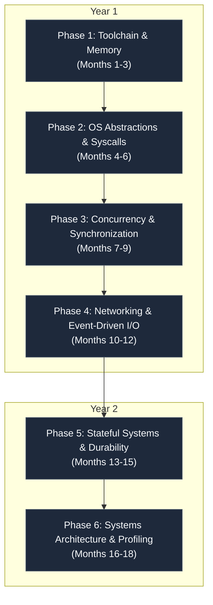

# Systems Engineering (Kỹ Thuật Hệ Thống)

Repository này đóng vai trò như một sổ tay kỹ thuật, môi trường thực nghiệm và bằng chứng cho quá trình rèn luyện chủ động (deliberate practice) theo **Chương Trình Cốt Lõi Kỹ Thuật Hệ Thống 18 Tháng** (18-Month Core Systems Engineering Curriculum).

Đây không phải là tập hợp ghi chú khóa học, tài liệu tra cứu cú pháp (cheatsheet), bài thực hành làm theo hướng dẫn (tutorial follow-alongs) hay ứng dụng mẫu dùng framework. Mỗi mục, phần cài đặt và bài kiểm thử hiệu năng (benchmark) tại đây được thiết kế nhằm cô lập và thấu hiểu cơ chế vận hành cốt lõi của hệ thống máy tính: **quyền sở hữu tài nguyên (resource ownership)**, **chuyển dịch trạng thái (state transitions)**, **các nguyên mẫu đồng thời (concurrency primitives)**, **trừu tượng hóa hệ điều hành (OS abstractions)**, **giao tiếp mạng (network communication)** và **mô hình thất bại khi vượt tải (failure modes under stress)**.

---

## Mục Lục (Table of Contents)
1. [Lý Do Tồn Tại (Why This Exists)](#1-lý-do-tồn-tại-why-this-exists)
2. [Triết Lý Học Tập (Learning Principles)](#2-triết-lý-học-tập-learning-principles)
3. [Lộ Trình Chi Tiết 18 Tháng (18-Month Curriculum Phases)](#3-lộ-trình-chi-tiết-18-tháng-18-month-curriculum-phases)
4. [Sơ Đồ Lộ Trình & Tiêu Chuẩn Chuyển Giai Đoạn (Roadmap & Execution Gates)](#4-sơ-đồ-lộ-trình--tiêu-chuẩn-chuyển-giai-đoạn-roadmap--execution-gates)
5. [Bộ Câu Hỏi Định Hướng Kỹ Thuật (Engineering Questions)](#5-bộ-câu-hỏi-định-hướng-kỹ-thuật-engineering-questions)
6. [Cấu Trúc Repository (Repository Structure)](#6-cấu-trúc-repository-repository-structure)
7. [Tiêu Chuẩn Công Cụ & Kiểm Thử (Tooling & Verification Standards)](#7-tiêu-chuẩn-công-cụ--kiểm-thử-tooling--verification-standards)

---

## 1. Lý Do Tồn Tại (Why This Exists)

Phần mềm hiện đại thường ẩn đi các thực tế phần cứng: độ trễ cấp phát bộ nhớ (allocation latency), phân cấp bộ nhớ đệm (cache hierarchies), chuyển ngữ cảnh (context switches), chuyển đổi không gian nhân (kernel transitions) và I/O mạng bất đồng bộ không định tính. Dù các trừu tượng hóa giúp đẩy nhanh tốc độ phát triển, việc xây dựng phần mềm có tính chống chịu cao (resilient) và hiệu năng vượt trội bắt buộc kỹ sư phải hiểu rõ điều gì xảy ra khi các trừu tượng đó bị rò rỉ hoặc thất bại.

Mục tiêu cốt lõi của repository bao gồm:
1. **Ghi lại quá trình rèn luyện chủ động (Document Deliberate Practice)**: Vượt qua việc sử dụng API bề nổi để thẩm thấu cơ chế vận hành bên trong của phần mềm.
2. **Xây dựng mô hình tư duy kỹ thuật (Cultivate Engineering Mental Models)**: Gắn kết thiết kế phần mềm với thực tế phần cứng (CPU caches, MMU, page tables, ring buffers, network stacks).
3. **Thiết lập kỷ luật Debug khoa học (Establish Rigorous Debugging Discipline)**: Xem debugging không phải là đoán mò thử-sai, mà là việc áp dụng phương pháp khoa học một cách hệ thống vào trạng thái phần mềm.
4. **Tạo ra các sản phẩm kiểm chứng được (Produce Verifiable Artifacts)**: Song hành kiến thức lý thuyết với code thực thi cụ thể, bộ kiểm thử chịu tải tự động (automated stress tests), bài đo hiệu năng (profiling benchmarks) và phân tích nguyên nhân gốc rễ (root-cause post-mortems).

---

## 2. Triết Lý Học Tập (Learning Principles)

### 2.1. Mô Hình Tư Duy Trên Hết (Mental Models Over Memorization)
Cú pháp API và framework thay đổi liên tục; tuy nhiên, nguyên lý phần cứng và các ràng buộc toán học của trạng thái phân tán thì không đổi. Ưu tiên hàng đầu là thấu hiểu:
* **Quyền sở hữu (Ownership)**: Ai cấp phát, ai thay đổi (mutate), ai giải phóng và ai đồng bộ hóa.
* **Trạng thái & Bất biến (State & Invariants)**: Trạng thái nào là hợp lệ, chuyển dịch nào được phép và làm sao giữ vững bất biến qua ranh giới thất bại.
* **Giao tiếp (Communication)**: Byte di chuyển thế nào qua các process, thread và mạng (chi phí copy, buffering, framing, backpressure).
* **Thất bại (Failure)**: Hệ thống hành xử ra sao khi ổ đĩa nghẽn, mất gói tin (packet drop), lỗi cấp phát bộ nhớ, hoặc deadlock thread.
* **Hiệu năng (Performance)**: Thiết kế tương thích phần cứng (hardware-sympathetic design), căn chỉnh cache line, băng thông bộ nhớ, dự đoán nhánh (branch prediction) và độ phức tạp thuật toán.

### 2.2. Vòng Lặp Xây Dựng → Phá Vỡ → Quan Sát → Sửa Lỗi (Build → Break → Observe → Fix Loop)
Sự học diễn ra ở ranh giới của sự cố. Mọi phần cài đặt đều tuân theo vòng lặp liên tục:
1. **Build**: Cài đặt trừu tượng cốt lõi từ nguyên lý đầu tiên (first principles) bằng công cụ chuẩn.
2. **Break**: Đưa vào dữ liệu độc hại (adversarial inputs), tranh chấp đồng thời (concurrency races), áp lực bộ nhớ (memory pressure) và bơm lỗi (fault injection).
3. **Observe**: Soi chiếu memory dump, dấu vết system call, CPU counter và báo cáo từ công cụ kiểm tra (GDB, perf, strace, Valgrind, Sanitizers).
4. **Fix**: Tái cấu trúc kiến trúc để bảo vệ bất biến, ngăn chặn cạn kiệt tài nguyên hoặc loại bỏ race condition.

### 2.3. Debugging Là Phương Pháp Khoa Học (Debugging as the Scientific Method)
Lỗi (bugs) là sự lệch pha giữa mô hình tư duy và mô hình thực thi. Mọi phiên debug đều tuân thủ:
* **Quan sát (Observation)**: Mô tả chính xác hiện tượng bất thường (ví dụ: SEGFAULT, hỏng dữ liệu, vọt độ trễ).
* **Giả thuyết (Hypothesis)**: Đưa ra phát biểu có thể bác bỏ (falsifiable) giải thích nguyên nhân gốc rễ dựa trên nguyên lý hệ thống.
* **Thêm công cụ đo (Instrumentation)**: Thêm assertions, hardware watchpoints, tracepoints hoặc tạo mã tái hiện tối thiểu để cô lập lỗi mà không làm biến đổi hành vi đang quan sát.
* **Xác minh (Verification)**: Chứng minh phương án sửa lỗi bằng cách xác nhận bài test tái hiện thất bại trước khi patch và vượt qua kiểm thử chịu tải sau khi sửa.

### 2.4. Nền Tảng Bền Vững Trước Khi Chuyên Sâu (Durable Fundamentals Before Specialization)
Ưu tiên các lĩnh vực kỹ thuật vượt thời gian: memory models, assembly conventions, POSIX system calls, I/O multiplexing, và lock-free synchronization trước khi sử dụng các framework hệ thống phân tán cấp cao hay công cụ chuyên biệt.

---

## 3. Lộ Trình Chi Tiết 18 Tháng (18-Month Curriculum Phases)

Chương trình được chia thành 6 Phase liên tiếp (mỗi Phase 3 tháng). Mỗi Phase khép lại bằng một đồ án cột mốc (milestone project) có đo kiểm hiệu năng, bộ test tự động và báo cáo debug chi tiết.

```
Months:  01-03        04-06        07-09        10-12        13-15        16-18
Phases: [Phase 1] -> [Phase 2] -> [Phase 3] -> [Phase 4] -> [Phase 5] -> [Phase 6]
Focus:   Toolchain    OS & Sys     Concurrency  Networking   Stateful     Architecture
         & Memory     Calls        & Atomics    & I/O Mux    Storage      & Scale
```

### Phase 1: Toolchain, Memory & Modern C++ Foundations (Tháng 1–3)
* **Trọng tâm**: Pipeline biên dịch (compilation pipeline), file nhị phân ELF, linker, layout bộ nhớ (Stack, Heap, BSS, Text), con trỏ (pointer semantics), RAII, value categories, và tự quản lý bộ nhớ.
* **Công cụ**: GCC, Clang, CMake, Make, `objdump`, `readelf`, `nm`, Valgrind, AddressSanitizer (ASan).
* **Khái niệm cốt lõi**: Alignment, padding, cache lines, virtual address space, arena/slab allocators, move semantics, zero-overhead abstractions.
* **Đồ án cột mốc (Milestone Project)**: **Deterministic Memory Pool Allocator** & bộ cài đặt Custom String/Vector hỗ trợ custom allocator, đảm bảo không bị phân mảnh bộ nhớ Heap (zero heap fragmentation).

### Phase 2: Operating Systems & System Call Abstractions (Tháng 4–6)
* **Trọng tâm**: Ranh giới User/Kernel space, system calls, bộ nhớ ảo (virtual memory), vòng đời process, xử lý signal, và nguyên mẫu file system.
* **Công cụ**: `strace`, `ltrace`, GDB, POSIX APIs, tra cứu `/proc` và `/sys`.
* **Khái niệm cốt lõi**: Context switching, page faults, `mmap`, Copy-on-Write (COW), File Descriptors (FD), File table vs Inode table, Inter-Process Communication (Pipes, Shared Memory, UNIX Domain Sockets).
* **Đồ án cột mốc (Milestone Project)**: **Minimal UNIX Process Supervisor & Custom POSIX Shell** hỗ trợ quản lý tiến trình (job control), chuyển hướng I/O (redirection), đường ống (piping) và truyền signal.

### Phase 3: Concurrency, Multithreading & Synchronization (Tháng 7–9)
* **Trọng tâm**: Hardware memory models, giao thức nhất quán cache (MESI), atomic operations, nguyên mẫu loại trừ tương hỗ (mutex primitives), và lỗi đồng thời.
* **Công cụ**: ThreadSanitizer (TSan), Helgrind, GDB thread inspection, `perf`.
* **Khái niệm cốt lõi**: Race conditions, Deadlocks, Livelocks, Priority Inversion, Memory Barriers, Sequential Consistency vs Acquire-Release Semantics, False Sharing.
* **Đồ án cột mốc (Milestone Project)**: **High-Throughput Bounded MPMC Lock-Free Ring Buffer** & Thread Pool hỗ trợ Work-Stealing.

### Phase 4: Networking Protocols & I/O Multiplexing (Tháng 10–12)
* **Trọng tâm**: Chồng giao thức mạng (OSI/TCP-IP), lập trình Socket, mô hình I/O Readiness/Completion, Non-blocking I/O và Framing.
* **Công cụ**: `tcpdump`, Wireshark, `netstat`/`ss`, `nc`, `curl`, `wrk`.
* **Khái niệm cốt lõi**: Trạng thái TCP state machine (Handshake, Teardown, TIME_WAIT), Flow control, Congestion control, Head-of-Line blocking, Sự kiện thông báo (epoll, kqueue, io_uring).
* **Đồ án cột mốc (Milestone Project)**: **Single-Threaded Event-Driven HTTP/1.1 & TCP Server** dựa trên `epoll`, xử lý hàng ngàn kết nối đồng thời với zero blocking calls.

### Phase 5: Stateful Client-Server Systems & Storage Engines (Tháng 13–15)
* **Trọng tâm**: Trạng thái lưu trữ bền vững (persistent state), tính bền vững dữ liệu (data durability), ghi nhật ký trước (Write-Ahead Logging - WAL), khôi phục sau sự cố (crash recovery), serialization, và giao thức mạng nhị phân.
* **Công cụ**: `fio`, kịch bản bơm lỗi sự cố (crash injection harnesses).
* **Khái niệm cốt lõi**: Tính chất ACID, chi phí `fsync`, Write Amplification, Append-only logs, LSM-Trees vs B+ Trees, nguyên lý cơ bản của State Machine Replication.
* **Đồ án cột mốc (Milestone Project)**: **Embedded Append-Only Key-Value Store** tích hợp WAL đảm bảo nhất quán khi crash, cơ chế nén dữ liệu (compaction) và giao thức mạng nhị phân tùy chỉnh.

### Phase 6: Systems Architecture, Failure Modes & Performance (Tháng 16–18)
* **Trọng tâm**: Đo kiểm hiệu năng mức hệ thống (system-level profiling), phân bố độ trễ đuôi (tail latency), độ bão hòa (saturation), suy giảm mượt mà (graceful degradation), và kiến trúc chống chịu lỗi.
* **Công cụ**: `perf`, FlameGraph, eBPF / `bpftrace`, bộ đo benchmark tùy chỉnh.
* **Khái niệm cốt lõi**: Lý thuyết hàng đợi cơ bản (Little's Law), Backpressure, Circuit Breaking, Cache Stampedes, Nút thắt cổ chai phần cứng (Memory bus vs CPU bound).
* **Đồ án cột mốc (Milestone Project)**: **End-to-End Distributed Fault-Tolerant Telemetry Collector & Query Service** đáp ứng SLA độ trễ đuôi và vượt qua các bài kiểm thử bơm lỗi tự động.

---

## 4. Sơ Đồ Lộ Trình & Tiêu Chuẩn Chuyển Giai Đoạn (Roadmap & Execution Gates)



### Tiêu Chuẩn Chuyển Giai Đoạn (Execution Gates)
Mọi quá trình chuyển Phase đều bắt buộc thỏa mãn 4 tiêu chuẩn nghiêm ngặt:
1. **Zero Undefined Behavior**: Không có warning khi dùng cờ `-Wall -Wextra -Wpedantic`, không có lỗi từ các công cụ Sanitizer (ASan, TSan, UBSan).
2. **Kiểm Thử Định Tính Tự Động (Deterministic Verification)**: Bộ test tự động kiểm tra các trường hợp biên (corner cases), xử lý hết bộ nhớ (OOM) và chuyển dịch trạng thái bất hợp lệ.
3. **Benchmark Có Thể Tái Hiện (Reproducible Benchmarks)**: Bài đo microbenchmark xác nhận băng thông (throughput), độ trễ (latency) và mức tiêu thụ tài nguyên dưới các mức tải khác nhau.
4. **Báo Cáo Phân Tích Sự Cố (Documented Post-Mortem)**: Ít nhất 1 bài viết phân tích kỹ thuật chi tiết về một lỗi phức tạp, nguyên nhân gốc rễ và giải pháp triệt để.

---

## 5. Bộ Câu Hỏi Định Hướng Kỹ Thuật (Engineering Questions)

Các câu hỏi này đóng vai trò kim chỉ nam trong suốt quá trình thực nghiệm và cài đặt code:

### Bộ Nhớ & Ranh Giới Phần Cứng (Memory & Hardware Boundary)
* Chuỗi sự kiện chính xác nào diễn ra từ khi CPU reset, gọi chương trình (`execve`), cho đến khi chỉ thị đầu tiên trong hàm `main()` được thực thi?
* Cấu trúc phân cấp Cache phần cứng, tính định vị không gian/thời gian (spatial/temporal locality) và hiện tượng False Sharing biểu hiện như thế nào trong các vòng lặp cập nhật tần suất cao?
* Chi phí vật lý và chi phí OS của Page Faults, TLB Misses và phân mảnh bộ nhớ (memory fragmentation) là bao nhiêu?

### Đồng Thời & Nhất Quán Phần Cứng (Concurrency & Hardware Coherence)
* Trong điều kiện nào trình biên dịch hoặc phần cứng được phép sắp xếp lại lệnh Read/Write (reordering), và mô hình Acquire-Release Memory Order ngăn chặn sự sắp xếp lại này như thế nào?
* Giao thức nhất quán Cache MESI giải quyết tranh chấp giữa nhiều nhân CPU cùng ghi vào các byte liền kề ra sao?
* Trong trường hợp nào Spinlock vượt trội hơn Mutex, và ở ngưỡng tranh chấp hoặc số nhân nào thì Spinlock gây ra sụt giảm hiệu năng toàn hệ thống?

### Hệ Điều Hành & I/O (Operating Systems & I/O)
* Kernel dịch một lệnh `read()` chặn (blocking) thành hoạt động thiết bị phần cứng như thế nào, và chi phí chính xác của quá trình chuyển ngữ cảnh (context switch) liên quan là bao nhiêu?
* Cấu trúc dữ liệu nội bộ nào được `epoll` duy trì trong kernel space, và tại sao chế độ Edge-Triggered lại bắt buộc đi kèm với Non-Blocking File Descriptors?
* Lệnh `fsync()` thực sự mang lại bảo chứng gì trên các phương tiện lưu trữ và file system khác nhau khi mất điện đột ngột?

### Mạng & Trạng Thái Phân Tán (Networking & Distributed State)
* Đánh đổi cơ học giữa hiện tượng Head-of-Line Blocking trong TCP và việc đa multiplex các luồng trên các giao thức dựa trên UDP là gì?
* Cơ chế Backpressure lan truyền từ socket buffer của bên nhận chậm ngược lên chồng giao thức mạng để tiết chế bên gửi như thế nào?
* Các bất biến (invariants) tồn tại ra sao qua ranh giới khởi động lại sau sự cố (crash-restart) khi cập nhật trạng thái trên nhiều file mà không có thao tác phần cứng nguyên tử (atomic hardware operations)?

---

## 6. Cấu Trúc Repository (Repository Structure)

Cấu trúc thư mục được tổ chức theo các miền kiến thức, cô lập mã nguồn sản phẩm, thực nghiệm, bài đo hiệu năng và nhật ký kỹ thuật:

```
Systems-Engineering/
├── curriculum/               # Danh sách các Phase, đề cương và tài liệu tham khảo
│   ├── phase-01-memory/
│   ├── phase-02-os/
│   ├── phase-03-concurrency/
│   ├── phase-04-networking/
│   ├── phase-05-storage/
│   └── phase-06-architecture/
├── projects/                 # Các hệ thống cột mốc được xây dựng qua lộ trình
│   ├── memory-allocator/     # Phase 1: Arena, Slab, và Pool allocators
│   ├── unix-shell/           # Phase 2: POSIX process supervisor & shell
│   ├── lockfree-queue/       # Phase 3: MPMC ring buffer & thread pool
│   ├── event-loop-server/    # Phase 4: Engine I/O non-blocking dựa trên epoll
│   └── wal-kv-store/         # Phase 5: Key-value store chống chịu sự cố với WAL
├── experiments/              # Mã nguồn thực nghiệm ngắn gọn, đơn file
│   ├── cache-locality/       # Độ trễ truy cập bộ nhớ Row-major vs Column-major
│   ├── memory-reordering/    # Tái hiện lỗi weak-ordering giữa các nhân CPU
│   ├── context-switch-cost/  # Đo độ trễ chuyển ngữ cảnh Thread vs Process
│   └── epoll-benchmarks/     # So sánh khả năng mở rộng select/poll vs epoll
├── investigations/           # Nhật ký debug chuyên sâu và báo cáo post-mortems
│   ├── 001-asan-heap-overflow/
│   └── 002-tsan-data-race/
├── docs/                     # Mô hình tư duy trực quan hóa và ghi chú kiến trúc
│   ├── memory-models.md
│   ├── tcp-lifecycle.md
│   └── synchronization-primitives.md
├── scripts/                  # Kịch bản đo hiệu năng, profiling và chạy Sanitizer
├── CMakeLists.txt            # Cấu hình build dự án cấp cao nhất
├── LICENSE                   # Giấy phép mã nguồn mở (MIT)
└── README.md                 # Tài liệu định hướng và chỉ mục kỹ thuật chính
```

---

## 7. Tiêu Chuẩn Công Cụ & Kiểm Thử (Tooling & Verification Standards)

Tất cả mã nguồn đưa vào repository bắt buộc tuân thủ các tiêu chuẩn biên dịch và kiểm tra nghiêm ngặt:

* **Chuẩn Ngôn Ngữ (Language Standard)**: Modern C++ (C++20 / C++23) sử dụng cờ `-std=c++20` hoặc `-std=c++23`.
* **Cảnh Báo Biên Dịch (Compiler Warnings)**: `-Wall -Wextra -Wpedantic -Wconversion -Wshadow -Werror`.
* **Kiểm Tra Công Cụ Sanitizer (Sanitizer Verification)**: Chạy sạch sẽ không lỗi qua:
  * AddressSanitizer (`-fsanitize=address`)
  * UndefinedBehaviorSanitizer (`-fsanitize=undefined`)
  * ThreadSanitizer (`-fsanitize=thread`)
* **Kiểm Tra Rò Rỉ Bộ Nhớ (Leak Checking)**: Chạy sạch sẽ dưới Valgrind:
  `valgrind --leak-check=full --show-leak-kinds=all --track-origins=yes`
* **Kỷ Luật Build (Build Discipline)**: Biên dịch out-of-source bằng CMake với các cấu hình riêng biệt cho `Debug`, `Release`, và `Sanitize`.

---
