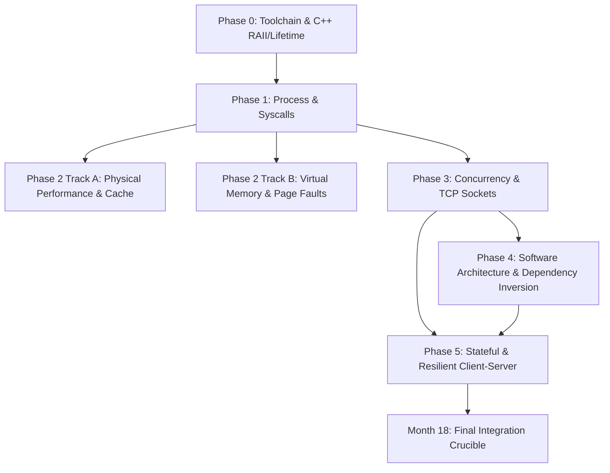

# Core Systems Engineering Curriculum Blueprint (18-Month Roadmap)

> **Mục tiêu**: Xây dựng tư duy kỹ sư hệ thống có khả năng khảo sát, phân tích và sửa lỗi các hệ thống máy tính phức tạp ("black-box systems") thông qua mô hình tư duy bền vững (durable mental models) thay vì học thuộc lòng lệnh hoặc API.

---

## Mục Lục (Table of Contents)
1. [Triết Lý Kỹ Thuật & Khung Tư Duy (Engineering Philosophy)](#1-triết-lý-kỹ-thuật--khung-tư-duy-engineering-philosophy)
2. [Kiến Trúc Phụ Thuộc Concept (Dependency Architecture)](#2-kiến-trúc-phụ-thuộc-concept-dependency-architecture)
3. [Lộ Trình Chi Tiết 18 Tháng (18-Month Timeline)](#3-lộ-trình-chi-tiết-18-tháng-18-month-timeline)
4. [Kế Hoạch Hàng Tháng & Tiến Độ (Month-by-Month Progress Checklist)](#4-kế-hoạch-hàng-tháng--tiến-độ-month-by-month-progress-checklist)
5. [Thực Thi Hàng Tuần - Mẫu Tháng 9 (Weekly Execution Prototype)](#5-thực-thi-hàng-tuần---mẫu-tháng-9-weekly-execution-prototype)
6. [Danh Sách Đồ Án Lớn (Project Specifications)](#6-danh-sách-đồ-án-lớn-project-specifications)
7. [Bộ Công Cụ Chuẩn & Môi Trường Debug (Toolchain & Environment)](#7-bộ-công-cụ-chuẩn--môi-trường-debug-toolchain--environment)
8. [Tiêu Chuẩn Đánh Giá Exit Gates (Exit Gate Evaluation Framework)](#8-tiêu-chuẩn-đánh-giá-exit-gates-exit-gate-evaluation-framework)
9. [Định Hướng Chuyên Sâu (Specialization Gates)](#9-định-hướng-chuyên-sâu-specialization-gates)
10. [Phạm Vi Hoãn Lại (Scope Control / Exclusions)](#10-phạm-vi-hoãn-lại-scope-control--exclusions)
11. [Thẻ Ôn Tập Active Recall (Flashcards & Self-Test Questions)](#11--thẻ-ôn-tập-active-recall-flashcards--self-test-questions)

---

<a id="1-triết-lý-kỹ-thuật--khung-tư-duy-engineering-philosophy"></a>
## 1. Triết Lý Kỹ Thuật & Khung Tư Duy (Engineering Philosophy)

### Kim Chỉ Nam (The North Star)
Khi đứng trước một hệ thống kiến trúc ẩn (black-box architecture), người học phải tự trả lời 10 câu hỏi cốt lõi:
- [ ] **What is running?** (Cái gì đang chạy?)
- [ ] **Where is the state?** (Trạng thái nằm ở đâu?)
- [ ] **Who owns the state?** (Ai sở hữu trạng thái?)
- [ ] **How does data move?** (Dữ liệu di chuyển như thế nào?)
- [ ] **Where is concurrency?** (Thành phần bất đồng bộ/đồng thời nằm ở đâu?)
- [ ] **What invariants must hold?** (Bất biến nào bắt buộc phải giữ vững?)
- [ ] **What can fail, and how is it detected and handled?** (Cái gì có thể lỗi, phát hiện và xử lý ra sao?)
- [ ] **Where is the bottleneck?** (Nút thắt cổ chai nằm ở đâu?)
- [ ] **How can the system be observed?** (Làm sao để quan sát hệ thống?)
- [ ] **Which layer should I descend into next to test a hypothesis?** (Nên hạ xuống tầng nào tiếp theo để kiểm chứng giả thuyết?)

### Vòng Lặp Debug (The Debugging Loop)
Debugging là việc áp dụng phương pháp khoa học vào hệ thống phần mềm:
```
Reproduce (Tái hiện) ➔ Observe (Quan sát) ➔ Hypothesize (Đưa giả thuyết) ➔ Measure (Đo lường) ➔ Locate Layer (Xác định tầng) ➔ Fix (Sửa) ➔ Verify (Xác minh)
```

> [!NOTE]
> **5 Lăng Kính Xuyên Suốt (Five Cross-Cutting Lenses)**
> 1. **Security & Risk**: Xác định vùng trusted/untrusted, dữ liệu malformed, cạn kiệt tài nguyên, invariant bị vi phạm.
> 2. **Performance**: Đo lường trước khi tối ưu. Kết nối thuật toán với layout dữ liệu, cache locality, syscall, I/O, contention và network.
> 3. **Resource Management**: Xác định tài nguyên giới hạn, quyền sở hữu/giải phóng, xử lý khi vượt tải (Backpressure).
> 4. **Trade-offs**: Không có kiến trúc tối ưu tuyệt đối. Cần hiểu rõ thiết kế tối ưu cái gì và đánh đổi cái gì.
> 5. **Targeted Mastery**:
>    - **L1 — Recognize**: Giải thích mô hình tư duy, lý do tồn tại và hậu quả nếu hiểu sai.
>    - **L2 — Reason**: Dự đoán hành vi, dùng API/công cụ đúng, chẩn đoán lỗi cơ bản và phân tích failure mode/trade-off.
>    - **L3 — Engineer**: Xây dựng subsystem hoàn chỉnh, cố tình làm hỏng, quan sát lỗi, đưa giả thuyết, debug và giải thích hành vi xuyên tầng.

> [!IMPORTANT]
> **Gates > Dates**: Lịch trình xác định ngân sách thời gian; Exit Gates quyết định việc chuyển giai đoạn. Nếu trượt Gate, dependency còn thiếu phải được củng cố ngay.

---

<a id="2-kiến-trúc-phụ-thuộc-concept-dependency-architecture"></a>
## 2. Kiến Trúc Phụ Thuộc Concept (Dependency Architecture)

Chương trình được thiết kế dạng **Đồ thị hướng không chu trình (DAG - Directed Acyclic Graph)**:



### Phân Loại Dependency:
- **Hard Dependency**: Bắt buộc hiểu A mới học được B.
- **Soft Dependency**: A hỗ trợ B, nhưng B có thể học trước khi làm chủ A.
- **Reinforcement**: A và B bổ trợ lẫn nhau, nên học gần nhau.
- **Integration**: Dự án tổng hợp hợp nhất nhiều concept trước đó.

---

<a id="3-lộ-trình-chi-tiết-18-tháng-18-month-timeline"></a>
## 3. Lộ Trình Chi Tiết 18 Tháng (18-Month Timeline)

| Giai đoạn | Thời gian | Tỷ trọng | Mục tiêu chính | Đồ án & Exit Gate |
| :--- | :--- | :--- | :--- | :--- |
| **Phase 0** | Tháng 1–2 | 10% | C++ Lifetime, RAII, Smart Pointers, [CMake](CMake) Toolchain Pipeline ([MIT Missing Semester](MIT_Missing_Semester) / [Modern C++ Docs](Modern_CPP_Docs)) | Multi-Module CLI Utility `[GATE 0]` |
| **Phase 1** | Tháng 3–4 | 15% | Program vs Process, User/Kernel space, Syscalls, Fork/Exec/Wait ([OSTEP](OSTEP) / [Linux man 2 pages](Linux_Man2_Pages)) | Strict Mini-Shell `[GATE 1]` |
| **Phase 2** | Tháng 5–6 | 15% | Cache Locality (Track A) & Virtual Memory / Page Faults (Track B) ([CS:APP](CSAPP) / [OSTEP](OSTEP)) | Locality Benchmark (AoS vs SoA) `[GATE 2]` |
| **Phase 3** | Tháng 7–10 | 25% | Threads, Mutex/CV, Socket API, TCP Stream & Partial I/O Framing ([OSTEP Concurrency](OSTEP_Concurrency) / [Beej's Guide](Beej_Guide)) | Raw Socket Stateful Server `[GATE 3]` |
| **Phase 4** | Tháng 11–13 | 15% | Coupling/Cohesion, Dependency Inversion, Unit Testing boundaries ([A Philosophy of Software Design](A_Philosophy_of_Software_Design) / [Clean Architecture](Clean_Architecture)) | The Great Refactoring `[GATE 4]` |
| **Phase 5** | Tháng 14–17 | 20% | State Authority, Failure Detection/Handling, Backpressure, Observability ([Understanding Distributed Systems](Understanding_Distributed_Systems)) | Stateful Collaborative Server `[GATE 5]` |
| **Crucible** | Tháng 18 | 5% | Interrogate unfamiliar black-box system, debug & measure | Core Complete |

---

<a id="4-kế-hoạch-hàng-tháng--tiến-độ-month-by-month-progress-checklist"></a>
## 4. Kế Hoạch Hàng Tháng & Tiến Độ (Month-by-Month Progress Checklist)

- [ ] **Month 1**: C++ Lifetime, Storage Duration, Ownership, RAII concepts ([Modern C++ Documentation](Modern_CPP_Docs)), Memory debugging labs ([MIT Missing Semester](MIT_Missing_Semester)).
- [ ] **Month 2**: Toolchain (Preprocessor ➔ Linker), [CMake](CMake) orchestration, Multi-module CLI project. `[GATE 0]`
- [ ] **Month 3**: User vs. Kernel space, Process abstraction ([OSTEP Chapter 4](OSTEP_Ch4)), File Descriptors ([Linux man 2 pages](Linux_Man2_Pages)), Syscall observation ([strace](strace)).
- [ ] **Month 4**: Process API ([OSTEP Chapter 5: Process API](OSTEP_Ch5) - `fork`/`exec`/`wait`), Mini-shell project. `[GATE 1]`
- [ ] **Month 5**: Memory Layout, Cache Lines, Locality, Access Patterns ([CS:APP Chapter 6](CSAPP_Ch6)), [perf](perf) profiling.
- [ ] **Month 6**: Virtual Memory, Address Translation, Page Fault mechanism ([OSTEP: Virtual Memory](OSTEP_VM)), Locality benchmark project. `[GATE 2]`
- [ ] **Month 7**: Thread Execution, Shared State, Race Conditions ([OSTEP Concurrency](OSTEP_Concurrency)), [TSan](ThreadSanitizer) lab.
- [ ] **Month 8**: Mutex, Condition Variables ([OSTEP Chapter 30: Condition Variables](OSTEP_Ch30) - Predicate waiting), Invariant protection, Thread Pool resource limits.
- [ ] **Month 9**: Socket API ([Beej's Guide to Network Programming](Beej_Guide)), TCP stream semantics, Partial Read/Write framing labs.
- [ ] **Month 10**: Integration: Raw Socket Stateful Server project ([Beej's Guide](Beej_Guide)). `[GATE 3]`
- [ ] **Month 11**: Coupling/Cohesion, Information Hiding, Deep Modules ([A Philosophy of Software Design](A_Philosophy_of_Software_Design)).
- [ ] **Month 12**: Dependency Direction vs. Injection ([Clean Architecture](Clean_Architecture)), Unit testing boundaries.
- [ ] **Month 13**: The Great Refactoring project. `[GATE 4]`
- [ ] **Month 14**: State Authority, Trust boundaries, Invalid state handling ([Understanding Distributed Systems](Understanding_Distributed_Systems)).
- [ ] **Month 15**: Failure Detection vs. Failure Handling ([Understanding Distributed Systems](Understanding_Distributed_Systems)), Stale state cleanup synchronization.
- [ ] **Month 16**: Resource limits, Bounded Queues, Backpressure policies, Observability concepts.
- [ ] **Month 17**: Stateful Collaborative Server project, Fault injection testing. `[GATE 5]`
- [ ] **Month 18**: Final Integration Crucible — Black-box system interrogation. `[CORE COMPLETE]`

---

<a id="5-thực-thi-hàng-tuần---mẫu-tháng-9-weekly-execution-prototype"></a>
## 5. Thực Thi Hàng Tuần - Mẫu Tháng 9 (Weekly Execution Prototype)

> **Chủ đề Tháng 9**: TCP Sockets & Framing

- [ ] **Week 1: Mechanism & Break**
  - *Mục tiêu*: Hiểu mapping từ File Descriptor sang Socket và bản chất byte-stream của TCP.
  - *Tài liệu*: [Beej's Guide to Network Programming](Beej_Guide) (Sockets, Bind, Listen, Accept).
  - *Lab*: Viết basic echo client/server. Cố tình gửi buffer cực lớn để phá vỡ giả định 1:1 send/recv.
  - *Debugging*: Quan sát phân mảnh gói tin (packet fragmentation).
- [ ] **Week 2: Observe & Hypothesize**
  - *Mục tiêu*: Làm chủ Partial I/O và Framing.
  - *Nhiệm vụ*: Bẫy Partial Read (ép client `send()` từng byte chậm).
  - *Debugging*: Giả thuyết trạng thái buffer và tái cấu trúc tin nhắn ở tầng ứng dụng.
- [ ] **Week 3: Implementation**
  - *Mục tiêu*: Hiện thực Protocol Layer bền vững.
  - *Nhiệm vụ*: Viết state-machine parsing dạng length-prefixed để gom byte stream thành logical message.
  - *Bằng chứng*: Unit test chứng minh mảng byte bị phân mảnh được parse thành công.
- [ ] **Week 4: Integration & Gate Prep**
  - *Mục tiêu*: Kết nối framed I/O với application state.
  - *Nhiệm vụ*: Xử lý partial write và kết thúc kết nối êm đẹp (graceful teardown).
  - *Bằng chứng*: Chạy sạch sẽ với [Valgrind](Valgrind)/[TSan](ThreadSanitizer) dưới tải cao.

---

<a id="6-danh-sách-đồ-án-lớn-project-specifications"></a>
## 6. Danh Sách Đồ Án Lớn (Project Specifications)

### Project 1: Multi-Module CLI Utility (Phase 0)
- **Mục tiêu**: Xây dựng phần mềm C++ đa module quản lý bằng [CMake](CMake) với quyền sở hữu RAII nghiêm ngặt ([MIT Missing Semester](MIT_Missing_Semester)).
- **Kiến trúc**: Core Static Library + CLI Executable.
- **Tiêu chuẩn nghiệm thu**: Biên dịch sạch sẽ; không rò rỉ bộ nhớ/truy cập bất hợp lệ dưới [Valgrind](Valgrind)/[ASan](Valgrind_ASan); không dùng `raw new/delete`.

### Project 2: Strict Mini-Shell (Phase 1)
- **Mục tiêu**: Thể hiện việc tạo process OS và trừu tượng hóa system call.
- **Kiến trúc**: Parse ➔ Fork ➔ Exec ➔ Wait.
- **Tiêu chuẩn nghiệm thu**: Xử lý đúng thất bại của `fork`/`exec`, thu dọn child process (tránh Zombie), báo cáo chính xác exit status.

### Project 3: Locality Benchmark (Phase 2)
- **Mục tiêu**: Đo lường ảnh hưởng của cache vật lý tới hiệu năng dựa trên layout bộ nhớ.
- **Kiến trúc**: So sánh cùng logic trên 2 layout: AoS (Array of Structures) vs SoA (Structure of Arrays).
- **Tiêu chuẩn nghiệm thu**: Báo cáo thực nghiệm chứng minh sự khác biệt hiệu năng trên tập dữ liệu đủ lớn ([CS:APP Chapter 6](CSAPP_Ch6)); giải thích nguyên nhân bằng cache lines qua [perf](perf).

### Project 4: Raw Socket Stateful Server (Phase 3)
- **Mục tiêu**: Quản lý thực thi đồng thời và luồng byte TCP thô.
- **Kiến trúc**: Multi-threaded Server xử lý nhiều clients.
- **Tiêu chuẩn nghiệm thu**: Xử lý đồng thời, buffer đúng partial reads/writes ([Beej's Guide](Beej_Guide)), vượt qua kiểm tra rượt đuổi dữ liệu (data races) của [ThreadSanitizer](ThreadSanitizer), giải quyết deadlock scenarios.

### Project 5: The Great Refactoring (Phase 4)
- **Mục tiêu**: Áp dụng Dependency Direction và cô lập ranh giới module ([A Philosophy of Software Design](A_Philosophy_of_Software_Design) / [Clean Architecture](Clean_Architecture)).
- **Kiến trúc**: Network Layer ➔ Protocol Layer ➔ Application Layer.
- **Tiêu chuẩn nghiệm thu**: Core application policy không phụ thuộc trực tiếp vào Network API; Unit tests kiểm tra framing/state invariants chạy hoàn toàn trên bộ nhớ (không cần I/O mạng).

### Project 6: Stateful Collaborative Server (Phase 5)
- **Mục tiêu**: Xây dựng hệ thống Client-Server resilient, state-authoritative ([Understanding Distributed Systems](Understanding_Distributed_Systems)).
- **Tính năng**: State validation, failure detection, cleanup synchronization, backpressure.
- **Tiêu chuẩn nghiệm thu**: Từ chối state proposal bất hợp lệ; phát hiện client ngắt kết nối; dọn dẹp stale state an toàn; áp dụng chính sách Backpressure (reject/drop/throttle) khi queue tràn.

---

<a id="7-bộ-công-cụ-chuẩn--môi-trường-debug-toolchain--environment"></a>
## 7. Bộ Công Cụ Chuẩn & Môi Trường Debug (Toolchain & Environment)

> **Môi trường chuẩn**: Windows Host + Linux (WSL2 hoặc Native) + VS Code Editor.

| Công cụ | Tầng hoạt động | Mục đích sử dụng |
| :--- | :--- | :--- |
| **[GCC / Clang](GCC_Clang)** | Compiler | Kiểm tra warning, tối ưu hóa, pipeline tạo object file |
| **[CMake](CMake)** | Build Orchestration | Quản lý compilation units và linking thư viện |
| **[GDB](GDB)** | Debugger | Kiểm tra memory, step execution, quan sát thread states |
| **[Valgrind / ASan](Valgrind_ASan)** | Memory Sanitizer | Kiểm tra RAII/Lifetime, phát hiện use-after-free, memory leaks |
| **[ThreadSanitizer (TSan)](ThreadSanitizer)** | Concurrency Sanitizer | Kiểm tra synchronization invariants, phát hiện data races ngầm |
| **[strace](strace)** | Syscall Profiler | Quan sát các system calls vượt qua ranh giới User/Kernel |
| **[perf](perf)** | Hardware Profiler | Đo đạc cache misses, CPU metrics, physical performance |

---

<a id="8-tiêu-chuẩn-đánh-giá-exit-gates-exit-gate-evaluation-framework"></a>
## 8. Tiêu Chuẩn Đánh Giá Exit Gates (Exit Gate Evaluation Framework)

Mọi Exit Gate đều đánh giá theo tiêu chuẩn **Pass/Fail** dựa trên 6 tiêu chí:

- [ ] **Knowledge Check**: Giải thích được mental model, lý do tồn tại và hậu quả khi vi phạm.
- [ ] **Implementation Check**: Xây dựng đồ án đáp ứng đầy đủ tiêu chí nghiệm thu hành vi.
- [ ] **Break Check**: Chủ động tạo ra lỗi mục tiêu (ví dụ: deadlock, linker error, zombie process).
- [ ] **Debugging Check**: Dùng toolchain chuẩn để định vị nguyên nhân bằng đo lường, không đoán mò.
- [ ] **Reasoning Check**: Giải thích nguyên nhân thất bại xuyên suốt các tầng trừu tượng.
- [ ] **Transfer Check**: Áp dụng nguyên lý vào câu hỏi chuyển giao (Transfer Question) mở rộng.

---

<a id="9-định-hướng-chuyên-sâu-specialization-gates"></a>
## 9. Định Hướng Chuyên Sâu (Specialization Gates)

Sau khi hoàn thành `CORE COMPLETE` (Tháng 18), kỹ sư có nền móng vững chắc để chuyển sang các hướng chuyên sâu:

- [ ] **Game Development (UE5)**: TCP framing & State authority ➔ Game networking, replication, synchronization.
- [ ] **Backend Engineering**: Concurrency invariants ➔ Transaction isolation, DB consistency, HTTP/gRPC, Rate limiting.
- [ ] **Cybersecurity**: Boundary testing ➔ Fuzzing, Memory safety, Exploitation mitigation.
- [ ] **Systems / Low-Level**: Virtual memory & Execution model ➔ Kernel, Drivers, Embedded systems.
- [ ] **HFT / High-Performance Engineering**: Cache locality & I/O reasoning ➔ Latency engineering, HFT systems.
- [ ] **Networking**: Socket API ➔ Custom Protocol Engineering, SDN.

---

<a id="10-phạm-vi-hoãn-lại-scope-control--exclusions"></a>
## 10. Phạm Vi Hoãn Lại (Scope Control / Exclusions)

Để tránh phình đại phạm vi (Scope Creep), các chủ đề sau **cố tình KHÔNG nằm trong 18 tháng cốt lõi**:
- **Advanced Data Structures & Algorithms**: Chỉ cần năng lực thuật toán cơ bản.
- **Production Databases (PostgreSQL, Redis)**: Hoãn lại tới Backend Specialization (cần tự quản lý state/concurrency trước).
- **Kubernetes / Cloud Deployments (AWS/GCP)**: Hoãn lại để tránh trừu tượng hóa quá sớm.
- **Distributed Consensus (Raft/Paxos) & Multi-node**: Hoãn lại; tập trung vào single-server / client-server.
- **Game Engines (Unreal/Unity)**: Hoãn lại tới Game Dev Specialization.
- **Offensive Cybersecurity / Exploitation**: Dùng security như lăng kính thiết kế chứ không học thủ thuật hack.

---

<a id="11--thẻ-ôn-tập-active-recall-flashcards--self-test-questions"></a>
## 11. Thẻ Ôn Tập Active Recall (Flashcards & Self-Test Questions)

<details>
<summary><b> [Phase 0] RAII và Smart Pointers hoạt động như thế nào?</b></summary>

- **Khái niệm**: RAII (Resource Acquisition Is Initialization) gắn liền vòng đời tài nguyên với vòng đời đối tượng stack. Khi đối tượng ra khỏi scope, destructor tự động giải phóng tài nguyên.
- **Con trỏ**:
  - `std::unique_ptr`: Sở hữu độc quyền (exclusive ownership).
  - `std::shared_ptr`: Sở hữu chia sẻ (shared ownership via reference counting).
  - `Raw Pointer / Reference`: Truy cập không sở hữu (non-owning access).
- **Lỗi tránh được**: Memory leak, double free, use-after-free, dangling pointer.
</details>

<details>
<summary><b> [Phase 1] Phân biệt Program và Process? Sự khác biệt giữa Zombie và Orphan process?</b></summary>

- **Program vs Process**: Program là tập hợp bytes tĩnh trên đĩa; Process là ngữ cảnh thực thi động trong bộ nhớ với tài nguyên riêng do OS quản lý.
- **Zombie Process**: Child process đã kết thúc nhưng Parent process chưa gọi `wait()` / `waitpid()` để thu dọn exit status.
- **Orphan Process**: Parent process kết thúc trước Child process. Child process sẽ được reparent cho `init` (PID 1) thu dọn.
</details>

<details>
<summary><b> [Phase 2] Page Fault là gì? Tại sao duyệt mảng 2D theo cột lại chậm hơn theo hàng?</b></summary>

- **Page Fault**: Là cơ chế phần cứng/OS khi địa chỉ bộ nhớ ảo được truy cập chưa có sẵn trong RAM vật lý. Page fault có thể hoàn toàn bình thường (demand paging) hoặc do truy cập trái phép (dẫn tới `SIGSEGV`).
- **Duyệt mảng 2D**: Trong C/C++, mảng 2D lưu theo thứ tự hàng (Row-Major Order). Duyệt theo hàng tận dụng được **Spatial Locality** (các phần tử kề nhau nằm chung 1 Cache Line 64-bytes). Duyệt theo cột gây Cache Miss liên tục vì nhảy ô nhớ xa.
</details>

<details>
<summary><b> [Phase 3] Mutex bảo vệ cái gì? Cạm bẫy Partial I/O trong TCP là gì?</b></summary>

- **Mutex**: Mutex không phải chỉ bảo vệ một biến; Mutex bảo vệ **Bất biến trạng thái (State Invariant)** hoặc một giao thức trạng thái dùng chung.
- **Partial I/O Trap**: TCP là luồng byte không có ranh giới tin nhắn (stream-oriented). Một lệnh `send()` không bảo đảm tương ứng 1 lệnh `recv()`. Ứng dụng phải dùng **Framing** (ví dụ: length-prefixed protocol) để gom đuôi byte hoàn chỉnh trước khi xử lý.
</details>

<details>
<summary><b> [Phase 4] Phân biệt Dependency Inversion Principle và Dependency Injection?</b></summary>

- **Dependency Inversion**: Là nguyên lý kiến trúc — Module cấp cao không phụ thuộc vào Module cấp thấp; cả hai phụ thuộc vào Trừu tượng (Abstraction).
- **Dependency Injection**: Là một kỹ thuật triển khai (implementation technique) để cung cấp dependency từ bên ngoài vào thay vì tự khởi tạo bên trong.
</details>

<details>
<summary><b> [Phase 5] Khác biệt giữa Failure Detection và Failure Handling? Backpressure là gì?</b></summary>

- **Failure Detection vs Handling**: Detection (Timeout, Heartbeat, Reset) phát hiện sự cố; Handling (Cleanup, Releasing State) xử lý dọn dẹp tài nguyên. Hai quá trình này phải đồng bộ hóa để tránh race condition.
- **Backpressure**: Là phản ứng của hệ thống khi tốc độ tới > tốc độ xử lý. Các chính sách xử lý bao gồm: Bounded queues, Reject mới, Throttle nguồn gửi, Drop gói tin ưu tiên thấp.
</details>

---
