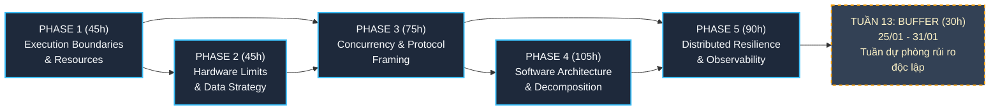

# SYSTEM ARCHITECT — FOUNDATIONAL LEARNING ROADMAP
> **Khung Thời Gian Khóa Chặt**: 01/11/2026 — 31/01/2027 (13 Tuần / 390 Giờ)  
> **Ngân Sách An Toàn**: 30 Giờ/Tuần (360 Giờ Học Chủ Động + 30 Giờ Buffer Dự Phòng)  
> **Mục Tiêu Tối Thượng**: Phát triển năng lực phân tích, thiết kế, ra quyết định và kiểm chứng kiến trúc hệ thống (**System Architect & Engineering Decision-Making**).

---

## Mục Lục (Table of Contents)
1. [Mục Tiêu Đào Tạo & 8 Năng Lực Đầu Ra (Architectural Competencies)](#1-mục-tiêu-đào-tạo--8-năng-lực-đầu-ra-architectural-competencies)
2. [Triết Lý Học Tập & Bộ Tiêu Chuẩn Lựa Chọn Kiến Thức (Pedagogical Philosophy)](#2-triết-lý-học-tập--bộ-tiêu-chuẩn-lựa-chọn-kiến-thức-pedagogical-philosophy)
3. [Kiến Trúc Phụ Thuộc Concept (DAG Dependency Architecture)](#3-kiến-trúc-phụ-thuộc-concept-dag-dependency-architecture)
4. [Lộ Trình Thực Chiến 13 Tuần & Ngân Sách Giờ (13-Week Backward Timeline)](#4-lộ-trình-thực-chiến-13-tuần--ngân-sách-giờ-13-week-backward-timeline)
5. [Hợp Đồng Chuẩn Bị Hạ Tầng Thực Nghiệm (Scaffolded Infrastructure Contract)](#5-hợp-đồng-chuẩn-bị-hạ-tầng-thực-nghiệm-scaffolded-infrastructure-contract)
6. [Nội Dung Chi Tiết Từng Phase: Kiểm Toán & Phạm Vi Phẫu Thuật](#6-nội-dung-chi-tiết-từng-phase-kiểm-toán--phạm-vi-phẫu-thuật)
7. [Tài Liệu Học Tập Chuẩn Mực & Phạm Vi Đọc Tinh Gọn (Canonical Reading Scope)](#7-tài-liệu-học-tập-chuẩn-mực--phạm-vi-đọc-tinh-gọn-canonical-reading-scope)
8. [Danh Sách 5 Đồ Án Kiến Trúc & Tiêu Chuẩn Exit Gates (Architectural Case Projects)](#8-danh-sách-5-đồ-án-kiến-trúc--tiêu-chuẩn-exit-gates-architectural-case-projects)
9. [Bộ Công Cụ Chuẩn & Môi Trường Quan Sát (Toolchain & Diagnostics)](#9-bộ-công-cụ-chuẩn--môi-trường-quan-sát-toolchain--diagnostics)
10. [Thẻ Ôn Tập Năng Lực Kiến Trúc (Active Recall Flashcards)](#10-thẻ-ôn-tập-năng-lực-kiến-trúc-active-recall-flashcards)

---

## 1. Mục Tiêu Đào Tạo & 8 Năng Lực Đầu Ra (Architectural Competencies)

Mục tiêu dài hạn của lộ trình là đào tạo năng lực của một **System Architect**. Công việc trọng tâm bao gồm:
* Phân tích yêu cầu, xác định đúng bài toán cốt lõi và các ràng buộc (constraints).
* Thiết kế cấu trúc tổng thể, phân rã subsystem, xác định boundaries và thiết lập interface contracts.
* Đưa ra quyết định kỹ thuật có cơ sở, phân tích đa chiều các trade-offs, risks và failure modes.
* Phân tích, chẩn đoán sự cố phức tạp (Root Cause Analysis) và thiết kế khả năng chống chịu (Resilience).
* Đánh giá và kiểm chứng các thuộc tính chất lượng (Quality Attributes: Performance, Scalability, Reliability, Security).
* Quản trị sự tiến hóa của kiến trúc theo thời gian khi yêu cầu và quy mô thay đổi.

> [!IMPORTANT]
> **Vai trò của Lập trình**: Lập trình là phương tiện thực nghiệm để hiểu cơ chế, kiểm chứng giả định và tái hiện sự cố; **không phải đầu ra nghề nghiệp chính của curriculum**. Không đo lường tiến độ bằng số dòng code hay khả năng nhớ API, mà bằng năng lực mô hình hóa, bảo vệ quyết định kiến trúc và xử lý sự cố.

### Tám Năng Lực Mục Tiêu (8 Core Competencies)
1. **System Thinking**: Mô hình hóa cấu trúc hệ thống, ranh giới (boundaries), trạng thái (state), tương tác (interactions), quan hệ phụ thuộc (dependencies) và vòng đời (lifecycle).
2. **Requirements Engineering**: Phân tích yêu cầu nghiệp vụ, ràng buộc kỹ thuật, định lượng thuộc tính chất lượng (SLIs/SLOs/SLAs, Latency p95/p99) và xác định tiêu chí thành công.
3. **System Architecture & Design**: Phân rã hệ thống, thiết kế module sâu (Deep Modules), thiết lập hợp đồng giao diện, xác định quyền sở hữu tài nguyên và áp dụng architectural patterns phù hợp.
4. **Engineering Decision-Making**: Đánh giá các phương án thay thế (alternatives), phân tích trade-offs đa chiều và lập hồ sơ quyết định kiến trúc (**ADR - Architecture Decision Records**).
5. **Resource & Concurrency Reasoning**: Quản trị tài nguyên (ownership, allocation, contention, exhaustion), bảo vệ bất biến trạng thái (state invariants), đồng bộ hóa và nhất quán dữ liệu.
6. **System Reliability & Troubleshooting**: Phân tích chế độ lỗi (failure modes), cô lập lỗi (fault containment), chẩn đoán nguyên nhân gốc rễ (Root Cause Analysis), phục hồi và thiết kế tự vệ (backpressure, load shedding).
7. **Performance & Scalability**: Phân tích điểm nghẽn (bottlenecks), lập kế hoạch dung lượng (capacity planning), cơ chế đệm (caching) và đánh giá độ trễ/thông lượng dưới các giới hạn vật lý.
8. **Architecture Validation & Evolution**: Kiểm chứng thiết kế bằng thực nghiệm tất định, đánh giá kiến trúc dựa trên kịch bản (scenario-based evaluation) và quản lý tái cấu trúc khi hệ thống mở rộng.

---

## 2. Triết Lý Học Tập & Bộ Tiêu Chuẩn Lựa Chọn Kiến Thức (Pedagogical Philosophy)

### 2.1. Thứ Tự Tư Duy Top-down
Mọi bài toán kỹ thuật đều tiếp cận theo trình tự:
$$\text{Problem} \longrightarrow \text{Requirements \& Constraints} \longrightarrow \text{System Decomposition} \longrightarrow \text{Interfaces \& Boundaries} \longrightarrow \text{Trade-off Decisions} \longrightarrow \text{Validation \& Evolution}$$

### 2.2. Tiêu Chuẩn Chuyển Giao Nền Tảng (The Universal Invariant)
Mọi chủ đề học tập đều phải trả lời được câu hỏi thẩm định:
> **"Nếu tôi không còn sử dụng Linux, C++ hay công nghệ đang học, năng lực nào tôi vẫn giữ lại được?"**  
> * Nếu câu trả lời là khả năng phân tích cấu trúc, mô hình hóa hành vi, thiết kế boundaries, lựa chọn architecture, reasoning về trade-offs và chẩn đoán sự cố: **Kiến thức đó ĐÁNG ĐẦU TƯ (HỌC)**.  
> * Nếu câu trả lời chỉ là nhớ cách gọi một API, biết một cờ bitwise hoặc thuộc một chi tiết cơ khí của phần cứng: **Dứt khoát LOẠI BỎ (KHÔNG HỌC)**.

### 2.3. Ba Lớp Phân Tích Độ Sâu (3-Layer Analysis)
Mỗi nhóm kiến thức được bóc tách thành 3 lớp để xác định trọng tâm nhận thức:
1. **Principles & Reasoning**: Nguyên lý cốt lõi, mô hình tư duy, đánh đổi kiến trúc và chế độ lỗi cần hình thành (Bắt buộc làm chủ).
2. **Mechanisms & Models**: Cơ chế kỹ thuật nền tảng cần hiểu để đưa ra quyết định chính xác và kiểm chứng hành vi (Hiểu sâu mô hình).
3. **Implementation Details**: API, flags, cú pháp, thông số vi mô (Chỉ tra cứu khi cần, không học vẹt).

Quyết định lựa chọn cuối cùng luôn mang tính nhị phân: **HỌC hoặc KHÔNG HỌC**.

---

## 3. Kiến Trúc Phụ Thuộc Concept (DAG Dependency Architecture)

Lộ trình được cấu trúc dạng đồ thị hướng không chu trình (DAG) dựa trên sự mở rộng dần của ranh giới hệ thống:

* **Từ Phase 1 lên Phase 2 & 3**: Hiểu đơn vị cô lập cơ bản nhất (Process) và cơ chế tham chiếu tài nguyên (FD 3-tier) trước khi chuyển sang chia sẻ bộ nhớ (Threads) hoặc cơ chế ảo hóa phần cứng (Virtual Memory).
* **Từ Phase 2 lên Phase 3**: Hiểu giới hạn vật lý của Cache Line và Memory Bus để lý giải nguyên nhân Lock Contention và False Sharing phá hủy thông lượng đa luồng.
* **Từ Phase 3 lên Phase 4**: Trải nghiệm sự phức tạp khi Network I/O và Concurrency trộn lẫn vào logic nghiệp vụ để thấy rõ giá trị sống còn của Phân rã Module và Dependency Inversion.
* **Từ Phase 4 lên Phase 5**: Ranh giới module sâu và độc lập là điều kiện tiên quyết để cô lập lỗi mạng và quản trị trạng thái trong môi trường phân tán.

---

## 4. Lộ Trình Thực Chiến 13 Tuần & Ngân Sách Giờ (13-Week Backward Timeline)

> **Ràng buộc cứng**: Hoàn thành toàn bộ lộ trình trước ngày **01/02/2027**.  
> **Ngân sách chuẩn**: 30 giờ/tuần $\times$ 13 tuần = **390 giờ** (360 giờ học chủ động + 30 giờ Buffer độc lập).

### Bảng Phân Bổ Ngân Sách Giờ & Hoạt Động Chi Tiết

| Phase | Thời gian lịch | Tổng giờ Phase | Đọc & Mô hình hóa | Thực nghiệm Toolchain | Case Study & ADR | Exit Gate Defense (Độc lập) |
| :--- | :--- | :---: | :---: | :---: | :---: | :---: |
| **Phase 1** | 01/11 ➔ 11/11/2026 | **45 giờ** | 15 giờ | 10 giờ | 13 giờ | **7 giờ** |
| **Phase 2** | 12/11 ➔ 22/11/2026 | **45 giờ** | 12 giờ | 10 giờ | 15 giờ | **8 giờ** |
| **Phase 3** | 23/11 ➔ 10/12/2026 | **75 giờ** | 20 giờ | 18 giờ | 25 giờ | **12 giờ** |
| **Phase 4** | 11/12/2026 ➔ 04/01/2027 | **105 giờ** | 30 giờ | 20 giờ | 40 giờ | **15 giờ** |
| **Phase 5** | 05/01 ➔ 24/01/2027 | **90 giờ** | 25 giờ | 20 giờ | 30 giờ | **15 giờ** |
| **TỔNG HỌC CHỦ ĐỘNG** | **12 tuần** | **360 giờ** | **102 giờ** | **78 giờ** | **123 giờ** | **57 giờ** |
| **TUẦN 13 (BUFFER WEEK)**| **25/01 ➔ 31/01/2027** | **30 giờ** | — | — | — | **Dự phòng rủi ro độc lập (30h)** |
| **TỔNG CỘNG LỘ TRÌNH** | **13 tuần** | **390 giờ** | *Khóa cứng hạn chót hoàn thành trước ngày 01/02/2027* |

### Đối Chiếu Thực Tế Nền Tảng Của Người Học
1. **Đã thành thạo (C++ RAII, Toolchain, CMake)**: Kiểm tra nhanh, zero-budget học lại; áp dụng ngay vào đọc hiểu codebase.
2. **Đã học (Day 001–003: User/Kernel mode, Process VAS, basic fork/exec/wait, UID/GID)**: Dành 5 giờ rà soát kiểm tra ranh giới, không học lại từ đầu.
3. **Đã học nhưng chưa vững (Mô hình 3 tầng FD, CLOEXEC race, Pipe Flow Control)**: Dành 10 giờ củng cố trọng điểm về invariants và causal mechanisms.
4. **Chưa học (Hardware Cache, Concurrency Invariants, Software Architecture, Distributed Resilience)**: Phân bổ trọn vẹn thời gian học mới theo chuẩn System Architect.

---

## 5. Nguyên Tắc Thiết Kế Thực Hành & Cấu Trúc Labs / Exit Gates (Hands-on C++ Engineering Principles)

> **Mục tiêu thực hành cốt lõi**: Giảm tối đa độ phức tạp triển khai không cần thiết (không viết parser chuỗi, không làm framework lớn), nhưng **giữ vững 100% tính thực hành chủ động**. Người học **tự tay viết code C++, tự compile trên Linux/WSL2, tự kích hoạt lỗi, tự debug và đo đạc** để hiểu thấu đáo cơ chế hệ thống.

### 5.1. Bốn Nguyên Tắc Thiết Kế Thực Hành
1. **Không lý thuyết suông — Ưu tiên C++ trên Linux/WSL2**: Mọi khái niệm Systems đều được kiểm chứng bằng một chương trình C++ nhỏ do người học tự viết và chạy trực tiếp. Tuyệt đối không thay thế C++ bằng Python chỉ vì tiện lợi, trừ khi có lý do đặc thù.
2. **Prototype nhỏ chứng minh cơ chế (50–120 dòng code)**: Loại bỏ các bài tập xây dựng sản phẩm hoàn chỉnh cồng kềnh. Một prototype C++ tinh gọn (ví dụ: runner `cmd1 | cmd2` 70 dòng) là hoàn toàn đủ để làm chủ `pipe()`, `dup2()` và `fork()`, không cần viết cả một Shell parser 1000 dòng.
3. **Cấu trúc chuẩn của mỗi Lab (4 thành tố bắt buộc)**:
   - **Cơ chế cần hiểu**: Hiện tượng hoặc quy luật hệ thống cần làm sáng tỏ.
   - **Tự triển khai bằng C++**: Phần code người học tự tay viết từ đầu hoặc chỉnh sửa trực tiếp.
   - **Quan sát / Đo đạc bằng công cụ**: Sử dụng `strace`, `perf`, `gdb`, `TSan` hoặc `/usr/bin/time -v` để nhìn thấy trạng thái kernel/phần cứng.
   - **Tiêu chí xác nhận kết quả**: Điều kiện định lượng để xác nhận bài tập thành công.
4. **Cấu trúc chuẩn của Exit Gate (4 chiều đánh giá)**:
   - **Giải thích cơ chế**: Dùng ngôn ngữ và mô hình của mình để giải thích nguyên lý nhân quả.
   - **Tự viết / Chỉnh sửa code C++ nhỏ**: Thao tác trực tiếp trên mã nguồn để hiện thực hóa hoặc sửa lỗi.
   - **Dự đoán & Kiểm chứng thực nghiệm**: Đưa ra giả thuyết trước khi chạy, sau đó đo lường để đối chiếu.
   - **Phân tích lỗi (Break-Check)**: Chủ động làm hỏng hệ thống (gây deadlock, race condition, handle leak) và giải thích nguyên nhân gốc rễ.

---

## 6. Nội Dung Chi Tiết Từng Phase: Kiểm Toán & Phạm Vi Phẫu Thuật

### PHASE 1: Execution Boundaries, Resource Lifecycles & Access Control (45 Giờ)
> **Trọng tâm**: Ranh giới thực thi, cô lập lỗi (Process), vòng đời tham chiếu tài nguyên (3-Tier Model), và điều tiết dòng chảy (Pipe Flow Control).

| Chủ đề | Quyết định | 1. Principles & Reasoning (Năng lực Kiến trúc) | 2. Mechanisms & Models (Mô hình kỹ thuật) | 3. Implementation Details (Chỉ tra cứu) |
| :--- | :---: | :--- | :--- | :--- |
| **Privilege Boundaries & Syscalls** | **HỌC** | **Security & Fault Containment**: Tại sao cần tách biệt đặc quyền; chi phí context switch; ranh giới tin cậy (Trust Boundary). | Mô hình 2 chế độ (User mode vs Kernel mode); cơ chế chuyển giao kiểm soát an toàn qua syscall gate. | Mã thanh ghi CPU (`RAX`, `RDI`), bảng vector ngắt, lệnh assembly `syscall`. |
| **Process Model & Address Space** | **HỌC** | **Isolation Boundary**: Không gian địa chỉ ảo là ranh giới cô lập lỗi tối thượng trên một node; một tiến trình sập không thể làm hỏng bộ nhớ tiến trình khác. | Phân vùng không gian địa chỉ tiến trình (Text, Data, Heap, Stack); mô hình bảo vệ bộ nhớ ảo. | Bit layout của thanh ghi MMU, địa chỉ hex cụ thể của kernel mapping. |
| **Process Lifecycle & Supervision** | **HỌC** | **Lifecycle Management & Resource Leaks**: Trách nhiệm của coordinator/parent; bài toán rò rỉ tài nguyên khi tiến trình con chết bất thường (zombie, orphan); graceful shutdown. | Mô hình nhân bản thực thi (`fork`), thay thế image (`execve`), và thu dọn trạng thái (`waitpid`). | Cờ chi tiết của `waitid`, các macro kiểm tra mã thoát hiếm gặp. |
| **Credentials & Access Control** | **HỌC** | **Least Privilege & Multi-tenancy**: Nguyên lý đặc quyền tối thiểu; cách thiết lập ranh giới phân quyền cho ứng dụng chạy đa người dùng/dịch vụ. | Phân định Real ID (quyền sở hữu) vs Effective ID (quyền thực thi); cơ chế drop privileges an toàn. | Các hàm phụ trợ `setresuid`, bảng số permission octal chi tiết. |
| **Resource Handles & 3-Tier Model** | **HỌC** | **Resource Ownership & Multiplexing**: Tài nguyên tồn tại độc lập với handle tham chiếu; reference counting; bài toán rò rỉ tài nguyên do chia sẻ handle qua ranh giới. | Mô hình 3 tầng POSIX: Bảng FD cục bộ tiến trình ➔ Bảng Open File Description toàn hệ thống ➔ Inode/vnode. | Số hiệu int của FD (0, 1, 2), cú pháp gọi hàm `fcntl`. |
| **Handle Inheritance & CLOEXEC** | **HỌC** | **Information Disclosure across Boundaries**: Nguy cơ rò rỉ tài nguyên bí mật sang tiến trình con; bài toán Race Condition trong thiết kế API khi chạy đa luồng. | Kế thừa handle qua `execve`; cờ `FD_CLOEXEC` / `O_CLOEXEC`; nguyên tắc thiết kế API nguyên tử (atomic API design). | Cú pháp `ioctl`, các cờ mở rộng riêng của Linux. |
| **Pipes & Stream Flow Control** | **HỌC** | **Backpressure & Bounded Buffers**: Mô hình đường ống dữ liệu (Data Pipeline); cơ chế tự điều tiết dòng chảy (Producer bị block khi Consumer xử lý chậm vì buffer đầy). | Kernel pipe buffer; tín hiệu EOF khi toàn bộ write-ends đóng; tín hiệu đứt gãy kết nối (`SIGPIPE`). | Dung lượng byte chính xác của `PIPE_BUF` trên từng distro Linux. |
| **Asynchronous Signals** | **HỌC** | **Interruption & Graceful Teardown**: Giao thức tối thiểu giữa OS và ứng dụng để yêu cầu dừng an toàn; trạng thái gián đoạn bất đồng bộ. | Xử lý ngắt cơ bản (`SIGINT`, `SIGTERM`, `SIGCHLD`); nguyên tắc Async-Signal-Safety (chỉ thao tác an toàn khi bị ngắt). | Chi tiết `sigaction` flags chuyên sâu, `sigaltstack`, signal masking bitmasks. |
| *Hardware Protection Tables (GDT, IDT, TSS)* | **KHÔNG HỌC** | — | — | **Lý do**: Chi tiết cơ khí x86; không giúp kiến trúc sư đưa ra quyết định tốt hơn về ranh giới hay cô lập tài nguyên. |
| *Complex Signal IPC (Real-time signals, queues)* | **KHÔNG HỌC** | — | — | **Lý do**: Signal IPC mang nhiều lỗi tiềm ẩn và khó debug; kiến trúc hiện đại dùng event loop, domain sockets và message queues. |

---

### PHASE 2: Physical Limits, Data Dynamics & Storage Trade-offs (45 Giờ)
> **Trọng tâm**: Giới hạn vật lý phần cứng, độ trễ Cache/RAM, đánh đổi cấu trúc dữ liệu (AoS vs SoA), áp lực bộ nhớ và chiến lược Caching.

| Chủ đề | Quyết định | 1. Principles & Reasoning (Năng lực Kiến trúc) | 2. Mechanisms & Models (Mô hình kỹ thuật) | 3. Implementation Details (Chỉ tra cứu) |
| :--- | :---: | :--- | :--- | :--- |
| **Memory Latency Hierarchy & Locality** | **HỌC** | **Mechanical Sympathy & Latency Scaling**: Chi phí vật lý của việc nhảy con trỏ ngẫu nhiên (Pointer Chasing) vs duyệt tuần tự; độ trễ Cache (vài ns) vs RAM (hàng chục ns). | Mô hình phân tầng bộ nhớ (Registers ➔ L1/L2/L3 ➔ RAM); Cache Line (64 bytes); Spatial & Temporal Locality. | Dung lượng cache chi tiết của từng dòng CPU; bảng chu kỳ xung nhịp (clock cycles). |
| **Data Layout Trade-offs (AoS vs. SoA)** | **HỌC** | **Data Architecture Trade-offs**: Đánh đổi giữa tính bao đóng của OOP (AoS - tiện cho dev) và hiệu suất băng thông bộ nhớ (SoA - tối ưu cho batch processing). | Bố cục bộ nhớ AoS vs SoA; Memory Alignment và Padding (khoảng đệm căn chỉnh byte). | Chỉ thị compiler `__attribute__((aligned))`, cú pháp `alignas`. |
| **Virtual Memory, Page Faults & Thrashing** | **HỌC** | **Capacity Overcommitment & Degradation**: Ảo hóa bộ nhớ cho phép chạy vượt dung lượng RAM thật nhưng trả giá bằng hiệu năng sụp đổ khi bị tráo đổi trang (Thrashing); OOM Killer. | Khái niệm Page (4KB); Minor vs Major Page Fault; Working Set của ứng dụng; Cơ chế Swap và rủi ro OOM. | Thuật toán page replacement nội bộ của kernel; cấu trúc bit của Page Table Entry (PTE). |
| **Caching Strategies & Invalidation** | **HỌC** | **Cache Architecture**: Các mẫu thiết kế Cache (Cache-aside, Write-through, Write-back); bài toán Cache Invalidation và rủi ro dữ liệu cũ (stale data). | Hit rate, Miss penalty, Eviction policies (LRU, LFU cơ bản), Invalidation patterns. | Cấu hình tham số chi tiết của Redis/Memcached. |
| *Custom Memory Allocators (Buddy, Slab from scratch)* | **KHÔNG HỌC** | — | — | **Lý do**: Kiến trúc sư cần hiểu hành vi của allocator (phân mảnh, lock contention) để chọn `jemalloc`/`tcmalloc`, không cần tự tay code allocator. |
| *Assembly-level CPU Profiling & Instruction Decoding* | **KHÔNG HỌC** | — | — | **Lý do**: Phạm vi của kỹ sư compiler/micro-architecture. Kiến trúc sư chỉ cần đo đạc ở mức metrics (Cache Miss Rate, Memory Bandwidth). |

---

### PHASE 3: Concurrency Invariants, Communication Protocols & Contention (75 Giờ)
> **Trọng tâm**: Bất biến trạng thái đồng thời (State Invariants), Deadlock, Bounded Thread Pool và Protocol Framing trên TCP byte-stream.

| Chủ đề | Quyết định | 1. Principles & Reasoning (Năng lực Kiến trúc) | 2. Mechanisms & Models (Mô hình kỹ thuật) | 3. Implementation Details (Chỉ tra cứu) |
| :--- | :---: | :--- | :--- | :--- |
| **Concurrency Models (Process vs. Thread vs. Event-Loop)** | **HỌC** | **Concurrency Paradigm Selection**: Đánh đổi giữa Cô lập bộ nhớ / Chi phí IPC (Process) vs Chia sẻ bộ nhớ / Rủi ro hỏng dữ liệu (Thread) vs I/O thông lượng cao (Event-driven). | Mô hình thực thi chia sẻ Heap/Data; chi phí context switch; non-blocking I/O multiplexing. | Cờ hàm `clone()`, cấu hình CPU thread affinity chi tiết. |
| **Shared State Invariants & Race Conditions** | **HỌC** | **State Integrity & Critical Sections**: Xác định bất biến trạng thái (Invariants); nhận diện thời điểm dữ liệu bị rơi vào trạng thái trung gian không hợp lệ do chạy đồng thời. | Data Race vs Race Condition; Vùng tranh chấp (Critical Section); Tính nguyên tử (Atomicity) ở mức logic. | Cú pháp gán biến atomic C++, macro compiler memory barriers. |
| **Coordination & Mutual Exclusion** | **HỌC** | **Contention vs. Throughput & Deadlock**: Đánh đổi giữa bảo vệ tính đúng đắn và thắt cổ chai hiệu năng; 4 điều kiện sinh Deadlock và chiến lược phòng chống deadlock. | Khóa loại trừ (Mutex), Biến điều kiện (Condition Variable - Predicate Loop), Read-Write Lock, Hàng đợi chờ. | Cú pháp `pthread_mutex_init`, các flags thuộc tính mutex nâng cao. |
| **Resource Bounding: Thread Pool & Task Queues** | **HỌC** | **Resource Exhaustion Prevention**: Chống sụp đổ hệ thống bằng cách giới hạn tài nguyên tính toán; chính sách xử lý khi hàng đợi tác vụ quá tải. | Mô hình Producer-Consumer; Hàng đợi có giới hạn (Bounded Queue); Worker Thread Pool; Chính sách loại bỏ tác vụ (Rejection policy). | Thuật toán Work-stealing nội bộ chi tiết, cấu trúc con trỏ ring buffer vi mô. |
| **Network Boundary & Sockets** | **HỌC** | **Crossing Machine Boundaries**: Ranh giới giao tiếp qua mạng; sự chuyển dịch từ môi trường tin cậy (bộ nhớ trong) sang môi trường có độ trễ và mất gói. | Mô hình Client-Server; Socket abstraction; Vòng đời kết nối TCP (3-way handshake, Established, Teardown). | Cấu trúc `sockaddr_in`, các hàm `htons`/`ntohs`, các socket options hiếm dùng. |
| **Stream Semantics & Application-Level Framing** | **HỌC** | **Protocol Invariants over Byte Streams**: TCP là dòng byte liên tục, không có ranh giới gói tin; ứng dụng bắt buộc phải tự thiết kế giao thức đóng gói (Framing) tin cậy. | Hiện tượng dồn gói/phân mảnh (Packet fragmentation); Hiện tượng đọc/ghi một phần (Partial Read/Write); Giao thức Length-prefixed vs Delimiter. | Cấu hình kích thước TCP window `SO_RCVBUF`, thuật toán Nagle (`TCP_NODELAY`) trừ khi gặp vấn đề về latency. |
| *Lock-free Data Structures & C++ Memory Ordering (`memory_order_*`)* | **KHÔNG HỌC** | — | — | **Lý do**: Tối ưu hóa vi mô với độ phức tạp nhận thức quá lớn. 99% kiến trúc hệ thống quy mô lớn sử dụng lock có cấu trúc, queue hoặc actor model. |
| *Raw Sockets & Thủ công can thiệp IP/TCP Headers* | **KHÔNG HỌC** | — | — | **Lý do**: Lĩnh vực chuyên biệt của network driver và bảo mật mạng. Kiến trúc sư làm việc từ transport/session layer trở lên. |

---

### PHASE 4: Software Architecture, System Decomposition & Decision Frameworks (105 Giờ)
> **Trọng tâm**: Phân rã hệ thống (Deep Modules), Đảo ngược phụ thuộc (Clean/Hexagonal Architecture), định lượng Quality Attributes, viết ADR và thiết kế ranh giới kiểm thử in-memory.

| Chủ đề | Quyết định | 1. Principles & Reasoning (Năng lực Kiến trúc) | 2. Mechanisms & Models (Mô hình kỹ thuật) | 3. Implementation Details (Chỉ tra cứu) |
| :--- | :---: | :--- | :--- | :--- |
| **Information Hiding & Deep Modules** | **HỌC** | **Complexity Management**: Module sâu (Giao diện đơn giản, hiện thực mạnh mẽ) vs Module nông; giảm thiểu thay đổi lan truyền (Change Amplification); "Define errors out of existence". | Nguyên lý che giấu thông tin; trừu tượng hóa hành vi; thiết kế giao diện tối giản. | Cú pháp C++ PIMPL idiom, các từ khóa truy cập `private`/`protected`. |
| **Coupling, Cohesion & Dependency Direction** | **HỌC** | **Stability & Independent Evolution**: Phân loại mức độ kết dính (Cohesion) và độ phụ thuộc (Coupling); quy luật luồng phụ thuộc: luôn hướng từ chi tiết biến động về phía chính sách ổn định. | Metric đánh giá coupling; phát hiện và bẻ gãy chu trình phụ thuộc (Circular dependencies). | Cấu trúc include guards, forward declarations trong C++. |
| **Boundary Design & Dependency Inversion** | **HỌC** | **Policy vs. Mechanism Decoupling**: Tách rời Logic nghiệp vụ (Core Policy) khỏi Chi tiết phân phối (Network Sockets, Storage, UI); Hexagonal Architecture (Ports & Adapters). | Interfaces / Abstract contracts; Dependency Injection; Data Transfer Objects (DTOs) làm ranh giới dữ liệu. | Các framework Dependency Injection container phức tạp. |
| **Requirements & Quality Attributes** | **HỌC** | **Architectural Quantification**: Định lượng Latency (p50, p95, p99), Throughput, Availability, Scalability, Maintainability; xây dựng kịch bản thuộc tính chất lượng (Quality Attribute Scenarios). | Kỹ thuật phỏng vấn kiến trúc, Trade-off matrix, định lượng SLO/SLA. | Các mẫu template tài liệu doanh nghiệp cồng kềnh. |
| **Engineering Decision-Making (ADRs)** | **HỌC** | **Architectural Documentation**: Kỹ năng lập hồ sơ quyết định kiến trúc (**Architecture Decision Records**); ghi nhận bối cảnh, phương án thay thế, trade-offs và hệ quả. | Cấu trúc chuẩn ADR (Context, Decision, Consequences, Alternatives Considered). | Công cụ quản lý ADR tự động. |
| **Architectural Testability** | **HỌC** | **Fast Deterministic Verification**: Đánh giá chất lượng kiến trúc bằng khả năng kiểm thử; ranh giới tốt cho phép test 100% logic trong RAM mà không cần dựng mạng hay database thật. | Ranh giới Unit Test; Test Doubles (Mocks, Stubs, Fakes); In-Memory Simulation. | Cú pháp matchers của GoogleTest, Catch2. |
| *23 GoF Design Patterns (Thuộc lòng và áp dụng máy móc)* | **KHÔNG HỌC** | — | — | **Lý do**: Dẫn đến overengineering, sinh ra hàng loạt class nông (shallow classes) làm rối loạn kiến trúc. Tập trung vào Deep Modules và Boundary Isolation. |

---

### PHASE 5: Distributed Systems, Resilience, Observability & Incident Diagnostics (90 Giờ)
> **Trọng tâm**: Thẩm quyền trạng thái (State Authority), lỗi mạng cục bộ (Partial Failures), cơ chế tự vệ (Backpressure), Observability toàn diện và chẩn đoán sự cố (Incident Post-Mortem).

| Chủ đề | Quyết định | 1. Principles & Reasoning (Năng lực Kiến trúc) | 2. Mechanisms & Models (Mô hình kỹ thuật) | 3. Implementation Details (Chỉ tra cứu) |
| :--- | :---: | :--- | :--- | :--- |
| **State Authority & Trust Boundaries** | **HỌC** | **Single Source of Truth**: Ai sở hữu quyền thay đổi trạng thái? Phân định ranh giới tin cậy giữa Client (không đáng tin) và Server (nắm quyền thẩm định); chống xung đột trạng thái. | State Validation; Authoritative State Store vs. Speculative Client State; Từ chối các đề xuất trạng thái bất hợp lệ. | Cú pháp serialize/deserialize JSON, Protobuf. |
| **Distributed Failure Modes & Partial Failures** | **HỌC** | **Design for Failure**: Trong hệ thống phân tán, lỗi luôn xảy ra một phần (mạng đứt, node crash, message thất lạc hoặc lặp lại); chấp nhận sự bất định của thời gian mạng. | Mô hình lỗi phân tán: Crash-stop vs Crash-recovery; Mất gói, Nhân bản gói tin; Phân vùng mạng (Network Partition). | Cấu hình tường lửa `iptables`, công cụ mô phỏng lag mạng. |
| **Failure Detection vs. Failure Handling** | **HỌC** | **Detection vs Mitigation**: Nhận biết một nút đã chết khác hoàn toàn với việc quyết định làm gì sau đó; tránh hành động phản ứng vội vã gây ra bão kết nối (Thundering Herd). | Cơ chế Heartbeat; Quá hạn (Timeouts); Đổi mới hạn thuê (Lease renewal); Dọn dẹp tài nguyên treo (Stale state cleanup); Exponential Backoff + Jitter. | Giá trị hằng số mili-giây cụ thể của timeout. |
| **System Self-Defense: Backpressure & Load Shedding** | **HỌC** | **Cascading Failure Prevention**: Khi tài nguyên đến giới hạn, hệ thống bắt buộc phải từ chối một phần việc để cứu phần còn lại; thà làm hỏng một số request có kiểm soát còn hơn để toàn bộ hệ thống sụp đổ. | Chính sách điều tiết: Chặn (Block) vs Hủy yêu cầu mới nhất (Drop tail) vs Hủy yêu cầu cũ nhất (Drop head) vs Từ chối tường minh (Reject / HTTP 429/503); Circuit Breaker. | Tham số cấu hình Nginx, Envoy proxy rate limiter. |
| **Distributed Consistency Models** | **HỌC** | **Fundamental Distributed Trade-offs**: Không thể có đồng thời dữ liệu nhất quán tuyệt đối và tính sẵn sàng cao khi mạng bị phân vùng; hiểu đánh đổi giữa Strong Consistency và Eventual Consistency. | Định lý CAP, PACELC; Mô hình Quorum cơ bản ($R + W > N$); Read-your-own-writes. | Chứng minh toán học hình thức của các mô hình phân tán. |
| **Observability Strategy** | **HỌC** | **System Telemetry**: Ba trụ cột: Metrics (Counters, Gauges, Histograms - đo p99), Structured Logs (truy vết ngữ cảnh), Distributed Tracing (Span ID, Trace ID); Health checks (Liveness vs Readiness). | OpenTelemetry concepts, Log aggregation, Trace propagation xuyên ranh giới dịch vụ. | Cú pháp cấu hình Grafana, Prometheus cụ thể. |
| **Incident Diagnostics & Post-Mortem** | **HỌC** | **Root Cause Analysis**: Phương pháp điều tra sự cố dựa trên giả thuyết; trích xuất telemetry để tái hiện timeline; viết Post-Mortem chuẩn văn hóa SRE/Architecture không đổ lỗi (Blameless Post-Mortem). | Timeline reconstruction, 5 Whys, Action items phòng ngừa sự cố lặp lại. | Mẫu biểu báo cáo nội bộ doanh nghiệp. |
| *Tự code thuật toán Raft / Paxos Consensus from scratch* | **KHÔNG HỌC** | — | — | **Lý do**: Tốn hàng tháng để debug lỗi trạng thái vi mô. Kỹ sư kiến trúc cần hiểu invariant và failure modes của Leader Election và Quorum để áp dụng, không cần tự viết consensus engine. |
| *Distributed Transactions (2-Phase Commit 2PC Implementation)* | **KHÔNG HỌC** | — | — | **Lý do**: 2PC là giao thức blocking dễ làm tê liệt hệ thống, hiếm khi dùng trong kiến trúc hiện đại. Chỉ cần hiểu lý do vì sao nó gây nghẽn (Explain). |

---

## 7. Tài Liệu Học Tập Chuẩn Mực & Phạm Vi Đọc Tinh Gọn (Canonical Reading Scope)

Chỉ đọc đúng các chương mục tiêu (dưới 40–50 trang mỗi Phase); tuyệt đối không đọc dàn trải:

| Giai đoạn | Tác phẩm chuẩn mực (Canonical Sources) | Phạm vi đọc thực tế (Chỉ đọc các phần này) | Phần bỏ qua (Không đọc để tránh lãng phí) |
| :--- | :--- | :--- | :--- |
| **Phase 1** | **OSTEP** (Remzi Arpaci-Dusseau) **TLPI** (Michael Kerrisk) | • **OSTEP**: Ch. 4 (Processes), Ch. 5 (Process API: `fork`, `exec`, `wait`). • **TLPI**: Ch. 44 (Pipes: mục 44.1, 44.2 về blocking & buffer). | Bỏ qua File System Internals, Terminal I/O, Advanced POSIX IPC, Xử lý signal chuyên sâu. |
| **Phase 2** | **CS:APP** (Bryant & O'Hallaron) **Tài liệu kinh điển Online** | • **CS:APP**: Ch. 6 (Memory Hierarchy & Locality: mục 6.1–6.4). • **Interactive**: *Latency Numbers Every Programmer Should Know*. | Bỏ qua Ch. 3 (Assembly), Ch. 4 (Processor Architecture), Ch. 9 (Tự viết Malloc Allocator). |
| **Phase 3** | **OSTEP** **Beej's Guide to Network Programming** | • **OSTEP**: Ch. 28 (Locks), Ch. 30 (Condition Variables: Producer-Consumer). • **Beej's Guide**: Ch. 5, 6 (Socket API & Client-Server Basics). | Bỏ qua Semaphore internals phức tạp, Lock-free algorithms, Raw Sockets, IPv6 header manipulation chi tiết. |
| **Phase 4** | **A Philosophy of Software Design** (John Ousterhout) **Clean Architecture** (Robert C. Martin) | • **Philosophy of Software Design**: Ch. 2, 4, 5, 6, 10 (Deep Modules, Information Hiding). • **Clean Architecture**: Ch. 15, 19, 22 (Architecture, Policy, Clean Architecture). | Bỏ qua các tranh cãi giáo điều về OOP vs Functional; không học thuộc các catalog design pattern lỗi thời. |
| **Phase 5** | **Designing Data-Intensive Applications** (Martin Kleppmann) **Understanding Distributed Systems** (Roberto Vitillo) | • **DDIA**: Ch. 1 (Reliable, Scalable, Maintainable), Ch. 8 (The Trouble with Distributed Systems). • **Vitillo**: Mục Resiliency (Timeouts, Retries, Circuit Breaker, Backpressure). | Bỏ qua Ch. 3 DDIA (Storage Engines B-Tree/LSM-Tree Internals), Proofs toán học của Consensus, Batch/Stream frameworks (Hadoop, Flink). |

---

## 8. Danh Sách 5 Đồ Án Kiến Trúc & Tiêu Chuẩn Exit Gates (Hands-on C++ Prototypes)

Mọi đồ án đều là **Prototype C++ tinh gọn (50–120 dòng code)** do người học tự tay triển khai, biên dịch và chạy trên Linux/WSL2. Exit Gates đánh giá trực tiếp trên 4 chiều: **Giải thích cơ chế**, **Viết/chỉnh sửa code C++**, **Dự đoán & Đo đạc**, và **Phân tích lỗi (Break-Check)**.

---

### Project 1: Mini-Shell — C++ Systems Integration Project (10 Giờ) (Phase 1)
Project thực hành tích hợp sau khi hoàn thành các bài về Process, `execve`, File Descriptors và Pipe trong Phase 1.

#### 1. Mục tiêu
Tự xây dựng một Mini-Shell bằng C++ trên Linux/WSL2, nhằm tích hợp kiến thức về process lifecycle, program execution, file descriptor management và IPC.
Sau khi hoàn thành, người học có thể:
- Hiểu và tự triển khai vòng lặp hoạt động cơ bản của một shell.
- Khởi chạy chương trình bên ngoài và quản lý vòng đời tiến trình con.
- Kết nối nhiều chương trình bằng pipeline.
- Hiểu vai trò của FD, `dup2()`, `close()` và EOF trong việc điều khiển luồng dữ liệu.
- Quan sát và giải thích hành vi hệ thống bằng `strace`.

#### 2. Phạm vi chức năng
Mini-Shell cần có những chức năng chính:
* **Command Execution**:
  - Hiển thị shell prompt và nhận lệnh.
  - Phân tích command thành tên chương trình và danh sách arguments.
  - Khởi chạy chương trình bên ngoài.
  - Chờ tiến trình hoàn thành và xử lý exit status.
  - Hỗ trợ tìm chương trình thông qua `PATH`.
* **Built-in Commands**:
  - `exit`: kết thúc shell.
  - `cd`: thay đổi working directory của chính shell.
* **Pipeline**:
  - Hỗ trợ pipeline cơ bản `cmd1 | cmd2`.
  - Chuyển stdout của chương trình trước thành stdin của chương trình sau.
  - Quản lý đúng các đầu pipe và vòng đời FD.
  - Không giới hạn ở một cặp lệnh nếu việc mở rộng lên nhiều lệnh vẫn nằm trong khả năng của project.
* **Error Handling**:
  - Xử lý command không tồn tại.
  - Xử lý lỗi khi tạo process hoặc pipe.
  - Đảm bảo tiến trình con không bị bỏ sót và tài nguyên được đóng đúng cách.

#### 3. Giới hạn phạm vi
Không triển khai:
- Shell scripting.
- Job control và background processes (`&`).
- Shell expansion, globbing, environment variable expansion.
- Parser hỗ trợ đầy đủ quoting và escaping.
- Input/output redirection (`<`, `>`, `>>`).
- Các tính năng nâng cao của Bash.  
*Ưu tiên một parser đơn giản, đủ phục vụ các chức năng trong phạm vi project.*

#### 4. Các nhóm thiết kế cần giải quyết
Người học tự quyết định thiết kế và cách triển khai các nhóm sau (không có code mẫu hay hướng dẫn từng bước):
- **Shell Loop & Command Parsing**: Vòng lặp tương tác và phân tích input.
- **Process Execution**: Ranh giới giữa shell parent, child process và external program.
- **Built-in Command Architecture**: Phân biệt lệnh cần chạy trong shell với chương trình bên ngoài.
- **Pipeline & FD Lifecycle**: Thiết kế luồng dữ liệu, quản lý FD và tránh deadlock.
- **Process Synchronization & Exit Status**: Thu hồi tiến trình con và xử lý kết quả thực thi.
- **Error Handling**: Các tình huống thất bại và cách phục hồi.

#### 5. Tiêu chí hoàn thành
- Có thể chạy các chương trình thông thường từ Mini-Shell.
- Có thể sử dụng `cd` và `exit` đúng ngữ nghĩa.
- Có thể chạy pipeline và nhận output chính xác.
- Không bị treo do quản lý FD sai.
- Xử lý được các lỗi cơ bản.
- Có thể dùng `strace` giải thích chuỗi syscall của một lần thực thi lệnh và pipeline.

#### 6. Tài liệu tham khảo (Giới hạn tối đa 3 tài liệu)
- Linux man-pages — [fork(2)](https://man7.org/linux/man-pages/man2/fork.2.html) và [execve(2)](https://man7.org/linux/man-pages/man2/execve.2.html).
- Linux man-pages — [pipe(7)](https://man7.org/linux/man-pages/man7/pipe.7.html).
- Linux man-pages — [dup(2)](https://man7.org/linux/man-pages/man2/dup.2.html).

#### 7. Thời lượng
- **Tổng thời gian dự kiến**: 10 giờ.
- Ước lượng dựa trên nền tảng hiện tại của người học: đã thực hành C++, `fork`, `execve`, `waitpid`, `pipe`, `dup2`, `close`, FD inheritance và `strace` trong Phase 0/Phase 1. Không tính thời gian như một người mới tiếp xúc với các cơ chế này.

* **Tiêu chuẩn Exit Gate 1 (7 Giờ Thẩm định độc lập)**:
  - [ ] **Giải thích**: Trình bày mô hình 3 tầng (FD Table ➔ OFD ➔ Inode) giải thích tại sao quên đóng write-end ở shell parent lại làm treo pipeline con.
  - [ ] **Code C++**: Tự tay xây dựng và debug Mini-Shell chạy được lệnh đơn, `cd`, `exit` và pipeline `cmd1 | cmd2`.
  - [ ] **Dự đoán & Đo đạc**: Dùng `strace` giải thích chuỗi syscall của một lần thực thi lệnh đơn và pipeline; quan sát quá trình thu dọn zombie bằng `waitpid()`.
  - [ ] **Phân tích lỗi**: Giải thích tại sao `cd` bắt buộc phải là builtin command mà không thể là external program.

---

### Project 2: Data-Oriented Micro-Benchmark trong C++ (AoS vs. SoA) (Phase 2)
* **Cơ chế kiểm chứng**: Chi phí vật lý của việc nhảy con trỏ (Pointer Chasing), độ trễ Cache Line (64 bytes), Spatial Locality và đánh đổi bố cục bộ nhớ AoS vs SoA.
* **Quy mô triển khai C++**: ~70–80 dòng C++ chuẩn mực.
* **Nhiệm vụ tự code**:
  1. Định nghĩa cấu trúc AoS: `struct ParticleAoS { float x, y, z; int id; char payload[32]; }` và SoA: `struct ParticleSoA { vector<float> x, y, z; ... }`.
  2. Tạo 1 triệu phần tử cho mỗi cấu trúc. Viết vòng lặp tính tổng tọa độ $X$ cho cả 2 cấu trúc.
  3. Đo thời gian thực thi bằng `std::chrono::high_resolution_clock`, biên dịch với `g++ -O2`.
* **Break-Check thực nghiệm**:
  - Tăng kích thước `payload` trong AoS từ 32 bytes lên 128 bytes ➔ Dự đoán thời gian tính toán của AoS sẽ tăng gấp bội dù số phép tính không đổi ➔ Đo bằng `perf stat` kiểm chứng L1-dcache-load-misses tăng vọt.
* **Tiêu chuẩn Exit Gate 2 (8 Giờ Thẩm định độc lập)**:
  - [ ] **Giải thích**: Giải thích tại sao SoA nhanh hơn AoS dựa trên cơ chế nạp Cache Line 64B của CPU.
  - [ ] **Code C++**: Tự tay viết hoặc sửa đổi vòng lặp xử lý dữ liệu và đo đạc thời gian bằng C++.
  - [ ] **Dự đoán & Đo đạc**: Dùng `perf stat` đo và đọc hiểu các chỉ số `L1-dcache-load-misses`, `instructions`, `cycles`.
  - [ ] **Phân tích Trade-off**: Trình bày rõ: Khi nào nên giữ AoS (OOP tiện cho dev) và khi nào bắt buộc tái cấu trúc sang SoA (data processing throughput).

---

### Project 3: Framed Protocol & Bounded Worker Queue trong C++ (Phase 3)
* **Cơ chế kiểm chứng**: Tính toàn vẹn của trạng thái dùng chung (State Invariants), cơ chế Producer-Consumer với Bounded Queue, và Protocol Framing trên dòng byte TCP.
* **Quy mô triển khai C++**: ~100–120 dòng C++ đa luồng.
* **Nhiệm vụ tự code**:
  1. Tự viết lớp `BoundedQueue<std::string>` bằng `std::mutex` và `std::condition_variable` (dung lượng cố định $K=5$, chặn khi đầy, chặn khi rỗng, chống spurious wakeups).
  2. Tự viết logic Framer (Length-prefixed): Đọc 4 bytes header xác định độ dài gói tin, sau đó đọc đủ payload mới chuyển thành message hoàn chỉnh.
  3. Khởi chạy 2 worker threads lấy message từ Bounded Queue để xử lý.
* **Break-Check thực nghiệm**:
  - Mô phỏng client gửi dồn 2 messages trong 1 gói TCP hoặc gửi tách 1 message thành từng byte lẻ ➔ Kiểm chứng Framer vẫn parse chính xác.
  - Biên dịch với `-fsanitize=thread` (`TSan`) ➔ Kiểm chứng hàng đợi không có bất kỳ Data Race nào dưới tải cao.
* **Tiêu chuẩn Exit Gate 3 (12 Giờ Thẩm định độc lập)**:
  - [ ] **Giải thích**: Trình bày vì sao TCP không bảo đảm ranh giới tin nhắn và tại sao Mutex phải đi kèm Condition Variable.
  - [ ] **Code C++**: Tự viết hoặc sửa một Bounded Queue chuẩn bằng `std::unique_lock` và predicate loop.
  - [ ] **Dự đoán & Đo đạc**: Dự đoán số lần blocking của Producer khi Queue đầy; quan sát `TSan` sạch lỗi.
  - [ ] **Phân tích Deadlock**: Phân tích kịch bản Deadlock khi có 2 mutex bị khóa sai thứ tự (Lock Ordering).

---

### Project 4: Boundary-Isolated Domain & In-Memory Testing trong C++ (Phase 4)
* **Cơ chế kiểm chứng**: Deep Modules, Information Hiding, Dependency Inversion (Hexagonal Ports & Adapters), và khả năng kiểm thử tất định trong bộ nhớ.
* **Quy mô triển khai C++**: ~80–100 dòng C++.
* **Nhiệm vụ tự code**:
  1. Định nghĩa Interface thuần ảo `IStream` (chứa `read()`, `write()`).
  2. Triển khai `InMemoryStream : public IStream` (dùng `std::vector<uint8_t>` giả lập dòng byte trong RAM).
  3. Xây dựng lớp nghiệp vụ `OrderProcessor` chỉ nhận `IStream&` để đọc request và gửi response, hoàn toàn không phụ thuộc vào Socket API hay Network Header.
  4. Viết bộ Unit Test kiểm thử toàn bộ các kịch bản hợp lệ và bất hợp lệ của `OrderProcessor` chạy 100% trong bộ nhớ.
* **Break-Check thực nghiệm**:
  - Thử nghiệm đổi cơ chế lưu trữ hoặc đổi giao thức truyền tải ➔ Chứng minh không phải sửa đổi bất kỳ dòng code nào trong `OrderProcessor`.
* **Tiêu chuẩn Exit Gate 4 (15 Giờ Thẩm định độc lập)**:
  - [ ] **Giải thích**: Trình bày nguyên lý Deep Modules và cách Dependency Inversion bảo vệ Core Domain Logic.
  - [ ] **Code C++**: Tự thiết kế một Interface trừu tượng và cài đặt Mock In-Memory Stream để test.
  - [ ] **Dự đoán & Đo đạc**: Chứng minh toàn bộ test suite chạy trong < 1 giây vì không có I/O đĩa hay mạng thật.
  - [ ] **Phân tích Ranh giới**: Chỉ ra các lỗi rò rỉ chi tiết hạ tầng (leaky abstractions) trong các thiết kế Shallow Modules.

---

### Project 5: Resilient Client-Server với Heartbeat & Load Shedding trong C++ (Phase 5)
* **Cơ chế kiểm chứng**: Phát hiện lỗi mạng (Heartbeat / Timeout), cơ chế tự vệ chống sụp đổ (Backpressure / Load Shedding) và Structured Logging khi gặp sự cố.
* **Quy mô triển khai C++**: ~120–140 dòng C++.
* **Nhiệm vụ tự code**:
  1. Viết server TCP theo dõi `last_seen_timestamp` của client. Nếu quá 3 giây không nhận gói Ping, chuyển trạng thái sang `DISCONNECTED` và thu dọn kết nối.
  2. Tích hợp chính sách Load Shedding: Khi hàng đợi công việc của server đạt 80% dung lượng, từ chối ngay lập tức các request mới bằng mã lỗi `ERR_OVERLOAD` thay vì tiếp tục nhận.
  3. Viết client gửi Ping định kỳ và gửi request tải. In structured logs (timestamp, client_id, event, queue_depth).
* **Break-Check thực nghiệm**:
  - Đột ngột kill tiến trình client (`kill -9`) ➔ Quan sát server phát hiện timeout sau đúng 3s và dọn dẹp state sạch sẽ.
  - Bắn 50 requests đồng thời vượt dung lượng ➔ Quan sát server trả về mã từ chối an toàn, không bị crash, không bị nghẽn RAM.
* **Tiêu chuẩn Exit Gate 5 (15 Giờ Thẩm định Tốt Nghiệp)**:
  - [ ] **Giải thích**: Trình bày sự khác biệt giữa Failure Detection và Failure Handling; nguyên lý Backpressure tự vệ.
  - [ ] **Code C++**: Tự viết hoặc sửa cơ chế Timeout State Machine và Load Shedding threshold trong C++.
  - [ ] **Dự đoán & Đo đạc**: Dự đoán số request bị từ chối khi tải tăng đột biến; kiểm tra log chứng minh server phục hồi.
  - [ ] **Phân tích Sự cố**: Đóng vai trò Architect giải thích nguyên nhân sập dây chuyền (Cascading Failure) và biện pháp phòng chống (Exponential Backoff + Jitter).

---

## 9. Bộ Công Cụ Chuẩn & Môi Trường Quan Sát (Toolchain & Diagnostics)

Mọi công cụ đều phục vụ việc **đo lường, kiểm chứng giả thuyết kiến trúc và chẩn đoán sự cố**:

| Công cụ | Tầng hoạt động | Mục đích sử dụng của System Architect |
| :--- | :--- | :--- |
| **`strace`** | OS Boundary | Quan sát các system calls vượt qua ranh giới User/Kernel; phát hiện rò rỉ FD và treo blocking I/O. |
| **`perf`** | Hardware Boundary | Đo đạc L1/L2 Cache misses, IPC và Memory Bandwidth để kiểm chứng quyết định bố cục dữ liệu. |
| **`ThreadSanitizer (TSan)`** | Concurrency Boundary | Phát hiện Data Race và vi phạm bất biến trạng thái (State Invariants) trong môi trường đa luồng. |
| **`OpenTelemetry / Mock Telemetry`** | Application & Network | Thu thập Metrics (p99 latency, error rate), Structured Logs và Distributed Tracing để chẩn đoán sự cố. |
| **`Chaos Scripts (Python/Bash)`** | Fault Injection | Bơm lỗi chủ động (mô phỏng lag mạng, ngắt kết nối đột ngột, quá tải requests) để kiểm chứng khả năng tự phục hồi. |

---

## 10. Thẻ Ôn Tập Năng Lực Kiến Trúc (Active Recall Flashcards)

<b> [Phase 1] Tại sao Process là ranh giới cô lập lỗi tối thượng trên một node? Cạm bẫy rò rỉ FD qua exec là gì?</b>

- **Cô lập lỗi (Fault Isolation)**: Mỗi Process sở hữu một Không gian Địa chỉ Ảo (VAS) riêng biệt do MMU và Kernel bảo vệ. Lỗi truy cập bộ nhớ (`SIGSEGV`) hoặc crash trong một tiến trình hoàn toàn không thể làm hỏng bộ nhớ của tiến trình khác.
- **Cạm bẫy rò rỉ FD**: Mặc định POSIX, File Descriptors được kế thừa qua `execve()`. Nếu tiến trình cha mở file chứa thông tin nhạy cảm (token, private key) rồi sinh tiến trình con thực thi mã bên thứ ba mà quên đặt cờ `O_CLOEXEC`, tiến trình con có thể đọc/ghi trực tiếp vào file đó.

<b> [Phase 2] Tại sao tối ưu thuật toán O(N) đôi khi không cứu được hiệu năng nếu vi phạm Cache Locality?</b>

- **Mechanical Sympathy**: Truy cập dữ liệu trong L1 Cache mất ~1ns, trong khi truy cập RAM vật lý mất ~50–100ns (chênh lệch hàng chục đến hàng trăm lần).
- **Hệ quả kiến trúc**: Một thuật toán $O(N)$ nhưng duyệt dữ liệu qua con trỏ ngẫu nhiên (Pointer Chasing trong cây nhị phân hoặc mảng đối tượng lớn AoS) sẽ liên tục gây Cache Misses, khiến CPU phải dừng chờ dữ liệu từ RAM, chậm hơn rất nhiều so với thuật toán xử lý tuần tự trên một mảng liền kề (SoA) tận dụng được Cache Line 64 bytes.

<b> [Phase 3] Mutex bảo vệ cái gì? Bản chất của Protocol Framing trên TCP là gì?</b>

- **Bảo vệ Invariant**: Mutex không phải chỉ bảo vệ một biến; Mutex bảo vệ **Bất biến trạng thái (State Invariant)** — khoảng thời gian dữ liệu rơi vào trạng thái trung gian không hợp lệ.
- **Protocol Framing**: TCP là một dòng byte liên tục (byte-stream), hoàn toàn không có khái niệm ranh giới gói tin. Một lần gửi (`send`) 100 bytes có thể đến bên nhận (`recv`) thành 20 bytes rồi 80 bytes, hoặc gom chung với gói tin tiếp theo. Ứng dụng bắt buộc phải tự thiết kế Framing (Length-prefixed hoặc Delimiter) để ghép đúng thông điệp logic.

<b> [Phase 4] Phân biệt Deep Module và Shallow Module? Tại sao Dependency Inversion giúp hệ thống dễ test?</b>

- **Deep vs Shallow Modules**: Deep Module có giao diện đơn giản nhưng che giấu hiện thực mạnh mẽ bên trong, giúp giảm gánh nặng nhận thức và hạn chế thay đổi lan truyền (Change Amplification). Shallow Module có giao diện cồng kềnh nhưng ruột rỗng, làm lộ chi tiết nội bộ ra ngoài.
- **Dependency Inversion & Testability**: Khi Core Domain chỉ phụ thuộc vào Interfaces trừu tượng (Ports) chứ không phụ thuộc vào Sockets hay Database (Adapters), ta có thể dễ dàng thay thế Socket thật bằng một In-Memory Mock Stream. Toàn bộ logic nghiệp vụ có thể được kiểm thử 100% trong vài giây mà không cần dựng mạng hay cài database thật.

<b> [Phase 5] Khác biệt cốt tử giữa Failure Detection và Failure Handling? Tại sao Backpressure cứu mạng hệ thống?</b>

- **Detection vs Handling**: Phát hiện lỗi (Timeout, Heartbeat) chỉ là nhận biết một thành phần không phản hồi; Xử lý lỗi (Cleanup state, Retry, Failover) là quyết định hành động. Phản ứng quá nhanh mà không có cơ chế Exponential Backoff + Jitter sẽ tạo ra bão yêu cầu (Thundering Herd), đánh sập toàn bộ các node còn lại.
- **Backpressure**: Khi tốc độ gửi vượt quá tốc độ xử lý, nếu không có cơ chế chặn hoặc loại bỏ tải (Drop/Reject), hàng đợi vô hạn sẽ bão hòa RAM, gây ra Page Thrashing hoặc kích hoạt OOM Killer làm sập toàn bộ dịch vụ. Backpressure là cơ chế tự vệ: thà từ chối một phần request có kiểm soát còn hơn để toàn bộ hệ thống sụp đổ.

---

> **Cam Kết Kỷ Luật**: Toàn bộ nội dung trên là kim chỉ nam chính thức, khóa chặt hạn chót hoàn thành trước ngày **01/02/2027**. Mọi hoạt động học tập hàng tuần đều phải bám sát ngân sách giờ và tiêu chí nghiệm thu của từng Phase.
